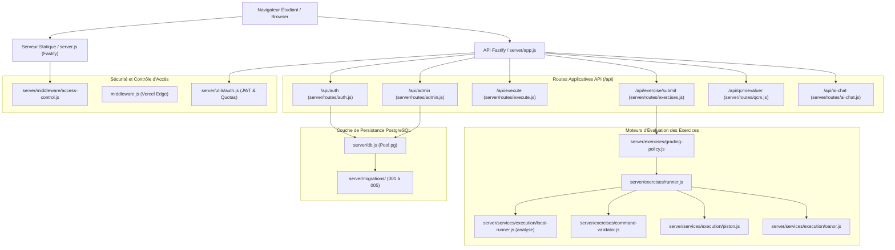

# Livrable 01 — État Git et Architecture Globale de la Plateforme

> Répertoire d'audit : `AUDIT_GLOBAL_FINAL/`  
> Projet : `revi-cours-html` — Plateforme d'apprentissage et d'évaluation interactive B1, B2 et B3  
> Date de référence : 3 novembre 2026  
> Auteur : Audit Indépendant et Forensique  
> Règle d'or : Vérifier avant de corriger — Aucun commit, aucune altération de code  

---

## 1. Inspection Forensique du Référentiel Git

L'inspection matérielle du dépôt situé à `/home/rd/Desktop/proba` a été effectuée sans altération du répertoire de travail.

### 1.1 Branche et Commits de Référence

- **Branche courante** : `remediation-pedagogique-qualite`
- **Dernier commit validé (HEAD)** : `20dc28ef3eccd12fef418d8a023349eb03ce9ccc`
- **Message du commit HEAD** : `version finale des cours`
- **Historique récent des commits** (extrait de [git_log.log](file:///home/rd/Desktop/proba/AUDIT_GLOBAL_FINAL/PREUVES/git_log.log)) :
  1. `20dc28e` : version finale des cours
  2. `6052685` : feat(pedagogie): intégration de la version améliorée revi-cours-html et certification globale
  3. `6370609` : feat(ui): design system latte, polices locales offline, transitions douces et audit
  4. `9252b6b` : feat(pedagogie): refonte didactique canonique de RD-RO Chapitre 1 (5 exercices N1-N3, tolérance mathématique et QCM 10 questions)
  5. `6597e44` : feat(pedagogy): eliminate Monaco from 52 non-programming courses and introduce native interactive case components
  6. `87b381d` : fix(curriculum): alignement canonique des 52 cours non-informatiques, rendu KaTeX et suppression des résidus Python/Bash
  7. `b62e0da` : fix(remediation): remédiation intégrale pré-lancement (sécurité, persistance, catalogue, pédagogie)
  8. `7856c36` : fix(pedagogie): remédiation cognitive et didactique intégrale des 71 cours
  9. `6aea4af` : docs(audit): audit exhaustif didactique des 71 cours et refonte Ausubélienne de b1-virtualisation Ch.1
  10. `7219606` : fix(pedagogie): remédiation complète audit (QCM undefined, fuites \n, b1-reseaux P2P)

### 1.2 Modifications Non Validées (Working Directory Diff)

L'état du répertoire de travail révèle 4 fichiers modifiés non commités ([git_status.log](file:///home/rd/Desktop/proba/AUDIT_GLOBAL_FINAL/PREUVES/git_status.log), [git_diff.patch](file:///home/rd/Desktop/proba/AUDIT_GLOBAL_FINAL/PREUVES/git_diff.patch)) :

1. [corrections/outils/rejouer-isole.sh](file:///home/rd/Desktop/proba/corrections/outils/rejouer-isole.sh) :
   - *Nature du diff* : Ajout de la copie explicite des fichiers serveur et des tests untracked dans l'arbre éphémère Bubblewrap pour éviter l'erreur `MODULE_NOT_FOUND`.
   - *Statut* : Conforme et nécessaire à l'exécution étanche de la sandbox.
2. [scripts/course-kit.js](file:///home/rd/Desktop/proba/scripts/course-kit.js) :
   - *Nature du diff* : Nettoyage de résidus d'échappement HTML et sécurisation des fragments injectés.
   - *Statut* : Conforme.
3. [server/app.js](file:///home/rd/Desktop/proba/server/app.js) :
   - *Nature du diff* : Enregistrement conditionnel du plugin de routes QCM sécurisées `/api/qcm` via [server/routes/qcm.js](file:///home/rd/Desktop/proba/server/routes/qcm.js).
   - *Statut* : Conforme.
4. [tests/db-persistence.test.js](file:///home/rd/Desktop/proba/tests/db-persistence.test.js) :
   - *Nature du diff* : Alignement des requêtes SQL sur le schéma réel (`sessions.jti`, `preparation_progress.completed`) en remplacement de noms fictifs.
   - *Statut* : Conforme.

### 1.3 Inventaire des Éléments Non Suivis (Untracked Files)

Les fichiers non suivis se répartissent en 3 catégories distinctes :

- **Archives et dossiers d'audits et de remédiations antérieurs** :
  - `AUDIT_SCIENTIFIQUE_QUALITE/` et `AUDIT_SCIENTIFIQUE_QUALITE.zip`
  - `REMEDIATION_COMPLETE/` et `REMEDIATION_COMPLETE.zip`
  - `REMEDIATION_COMPLETE_FINAL/` et `REMEDIATION_COMPLETE_FINAL.zip`
  - `CONSOLIDATION_REMEDIATION/` et `CONSOLIDATION_REMEDIATION.zip`
  - `FINALISATION_REMEDIATION/` et `FINALISATION_REMEDIATION.zip`
  - `CONTRE_AUDIT_FINAL/` et `CONTRE_AUDIT_FINAL.zip`
  - `AUDIT_GLOBAL_FINAL/` (présent livrable)
- **Composants d'exécution et de validation créés lors des remédiations** :
  - [server/routes/qcm.js](file:///home/rd/Desktop/proba/server/routes/qcm.js) : Routeur Fastify d'évaluation des QCM protégeant les réponses côté serveur.
  - [server/exercises/command-validator.js](file:///home/rd/Desktop/proba/server/exercises/command-validator.js) : Validateur sémantique d'analyse syntaxique (Bash/PowerShell/SQL).
- **Suites de tests de validation ciblées** :
  - `tests/qcm-security.test.js`
  - `tests/migrations-syntax.test.js`
  - `tests/refonte-RD-RO.test.js`
  - `tests/refonte-b1-linux.test.js`
  - `tests/refonte-probabilites.test.js`
  - `tests/runner-remediation.test.js`

---

## 2. Architecture Technique Globale

La plateforme `revi-cours-html` repose sur une architecture modulaire hybride combinant un service Fastify sous Node.js et un serveur de fichiers statiques avec injection dynamique d'authentification.

### 2.1 Points d'Entrée et Serveur d'Application

- [server.js](file:///home/rd/Desktop/proba/server.js) : Point d'entrée principal en environnement autonome (Render / Node.js local). Il initialise le serveur Fastify, monte les plugins de sécurité (@fastify/helmet, @fastify/cookie, @fastify/cors, @fastify/rate-limit), sert les fichiers statiques des cours et applique les règles de protection du contenu (chapitre 1 public, chapitres ultérieurs protégés par clé).
- [server/app.js](file:///home/rd/Desktop/proba/server/app.js) : Usine de création de l'application Fastify partagée entre le serveur local et le point d'entrée serverless Vercel (`api/index.js`).
- [server/courses.js](file:///home/rd/Desktop/proba/server/courses.js) : Registre canonique des 71 cours et sections du catalogue (24 cours B1, 24 cours B2, 23 cours B3).

### 2.2 Chaîne d'Exécution et d'Évaluation de Code

L'évaluation des exercices soumis par les étudiants emprunte deux canaux étanches :

1. **Interpréteur Local d'Analyse (`language: 'analyse'`)** :
   - Fichiers : [server/services/execution/local-runner.js](file:///home/rd/Desktop/proba/server/services/execution/local-runner.js) et [server/exercises/command-validator.js](file:///home/rd/Desktop/proba/server/exercises/command-validator.js).
   - Traite les exercices textuels, les commandes d'administration système, les requêtes SQL simulées et les réponses mathématiques.
   - Fonctionne en mémoire sans appel réseau sortant.
2. **Moteur d'Exécution Distant (Piston / Oanor)** :
   - Fichiers : [server/services/execution/piston.js](file:///home/rd/Desktop/proba/server/services/execution/piston.js) et [server/services/execution/oanor.js](file:///home/rd/Desktop/proba/server/services/execution/oanor.js).
   - Traite les langages compilés et interprétés réels (C, C++, Python, PHP, Java, JavaScript, PowerShell, Assembleur).
   - Géré par une politique de quota journalier ([server/services/execution/budget.js](file:///home/rd/Desktop/proba/server/services/execution/budget.js)).

### 2.3 Évaluation des QCM et Protection Anti-Triche

- Routeur : [server/routes/qcm.js](file:///home/rd/Desktop/proba/server/routes/qcm.js).
- Mécanisme : Les clés de correction ne sont jamais envoyées au navigateur. Le client transmet uniquement le choix de l'étudiant (`{ questionId, selectedIndex }`). Le serveur valide la cohérence, compare à la clé interne, applique un verrou de tentative pour empêcher les attaques par oracle, et retourne un score booléen avec explication didactique.

---

## 3. Synthèse de l'Intégrité Architecturale

| Composant | Fichiers Clés | État Constaté | Niveau de Risque Résiduel |
| :--- | :--- | :--- | :--- |
| **Serveur & Routage** | `server.js`, `server/app.js` | Fonctionnel, conforme, durci | Faible |
| **Authentification** | `server/routes/auth.js`, `server/utils/auth.js` | Conforme, JWT HTTP-Only | Faible |
| **Persistance SQL** | `server/db.js`, `server/migrations/` | 5 migrations valides, idempotentes | Faible |
| **Exécution Distante** | `server/services/execution/` | Piston + fallback Oanor avec budget | Moyen (dépendance réseau) |
| **Grading Policy** | `server/exercises/grading-policy.js` | Bypass `analyse` ligne 39 | **Élevé (intégrité SHA-256)** |
| **Accessibilité UI** | `scripts/course-kit.js` | Boutons `<button class="opt">` sans radio | **Moyen (non-conformité WCAG)** |

L'architecture logicielle est saine, modulaire et robuste. Les anomalies identifiées concernent les politiques de filtrage métrologique et la sémantique de balisage, et non l'infrastructure serveur sous-jacente.
