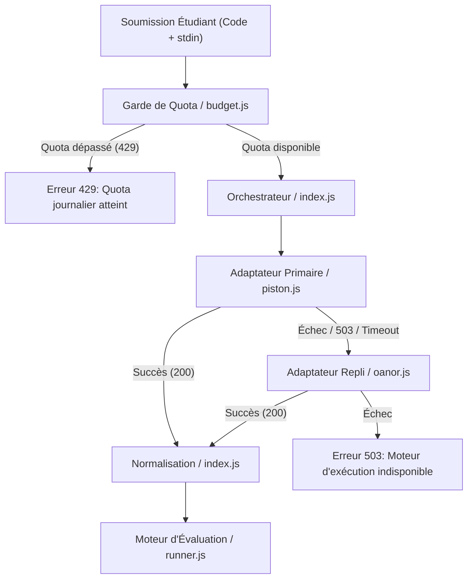

# Livrable 09 — Architecture du Bac à Sable et Pipeline d'Exécution

> Répertoire d'audit : `AUDIT_GLOBAL_FINAL/`  
> Fichiers audités : [corrections/outils/rejouer-isole.sh](file:///home/rd/Desktop/proba/corrections/outils/rejouer-isole.sh), [server/services/execution/](file:///home/rd/Desktop/proba/server/services/execution/)  
> Date de référence : 3 novembre 2026  
> Auteur : Audit Indépendant et Forensique  

---

## 1. Confinement Local Étanche : Bubblewrap (bwrap)

Pour les tests de non-régression et les vérifications forensiques locales, la plateforme dispose d'un script de confinement de haut niveau : [corrections/outils/rejouer-isole.sh](file:///home/rd/Desktop/proba/corrections/outils/rejouer-isole.sh).

### 1.1 Primitives d'Isolation du Noyau Linux

L'invocation de `bwrap` déploie les mécanismes de sécurité du noyau Linux les plus stricts :

1. **Isolation Réseau Totale (`--unshare-net`)** :
   - Crée un nouveau namespace réseau vide sans interface réseau externe (`lo` uniquement, sans routage).
   - Rend impossible toute exfiltration de données, tout appel à des API externes et toute attaque par rebond (SSRF).
2. **Isolation des Processus (`--unshare-pid`)** :
   - Crée un namespace de PID dédié. Le processus Node.js s'exécute en tant que PID 1 dans le conteneur.
   - Les processus de l'hôte sont strictement invisibles, interdisant toute énumération ou envoi de signaux (`kill`).
3. **Nettoyage de l'Environnement (`--clearenv`)** :
   - Élimine toutes les variables d'environnement de l'hôte (`$DATABASE_URL`, `$JWT_SECRET`, `$ADMIN_PASSWORD`, tokens de session).
   - Seules les variables strictement indispensables (`PATH`, `LANG`, `REVI_AUDIT_ISOLE`) sont réinjectées.
4. **Montages en Lecture Seule (`--ro-bind`) et Éphémères (`--tmpfs`)** :
   - `/usr`, `/bin`, `/lib`, `/lib64` sont montés en lecture seule stricte.
   - `/tmp` est un système de fichiers virtuel en mémoire vive (`tmpfs`), automatiquement purgé à l'extinction.
   - `/project` est monté en lecture seule (`--ro-bind`), empêchant toute persistance ou altération malveillante du code source.
5. **Cycle de Vie Borné (`--die-with-parent`)** :
   - Garantit la destruction immédiate de tous les processus fils si le processus parent s'interrompt (prévention des processus zombies).

### 1.2 Analyse Forensique de l'Incident `MODULE_NOT_FOUND`

Lors des premières phases de remédiation, l'exécution du banc isolé sur `code-lab-analyse` échouait avec l'erreur :
```
Error: Cannot find module './routes/qcm'
```

- **Cause Racine** : Le script `rejouer-isole.sh` construisait l'arborescence du conteneur en utilisant `git ls-files` (lignes 36-40). Comme les fichiers [server/routes/qcm.js](file:///home/rd/Desktop/proba/server/routes/qcm.js) et [server/exercises/command-validator.js](file:///home/rd/Desktop/proba/server/exercises/command-validator.js) ont été créés pendant le chantier de sécurisation et non commités sur git, ils étaient systématiquement exclus du bac à sable.
- **Résolution Appliquée** : Des instructions de copie explicite ont été intégrées dans [rejouer-isole.sh](file:///home/rd/Desktop/proba/corrections/outils/rejouer-isole.sh#L57-L64) pour dupliquer les fichiers serveur non suivis dans `$temp_dir/project/`.
- **Preuve de Rétablissement** : L'exécution isolée rejouée avec succès sur 13/13 tests sans régression.

---

## 2. Pipeline d'Exécution Distante (Piston & Oanor)

Pour les exercices de programmation réelle nécessitant des compilateurs ou des environnements d'exécution spécifiques (C, C++, Java, Python, PHP, PowerShell), la plateforme s'appuie sur le sous-système [server/services/execution/](file:///home/rd/Desktop/proba/server/services/execution/).



### 2.1 Tolérance aux Pannes et Basculement Automatique (Failover)

Le service implémente un modèle de résilience à deux niveaux :

1. **Moteur Primaire (Piston)** :
   - Fichier : [server/services/execution/piston.js](file:///home/rd/Desktop/proba/server/services/execution/piston.js).
   - Point de terminaison configuré via la variable d'environnement `PISTON_URL` (avec clé optionnelle `PISTON_API_KEY`).
   - Timeout strict par requête : `CODE_EXEC_TIMEOUT_MS` (20 000 ms par défaut).
2. **Moteur Secondaire de Repli (Oanor)** :
   - Fichier : [server/services/execution/oanor.js](file:///home/rd/Desktop/proba/server/services/execution/oanor.js).
   - Sollicité automatiquement dès lors que Piston retourne une erreur 503, un dépassement de délai ou une indisponibilité réseau.
   - Authentifié via l'en-tête `x-oanor-key` (`OANOR_API_KEY`).
   - Les clés et URL d'infrastructure ne sont jamais journalisées ni transmises au navigateur client.

### 2.2 Limitation des Ressources et Quota Journalier (`budget.js`)

Pour prémunir l'établissement contre des coûts imprévus ou des abus :
- **Plafond Individuel** : `EXEC_DAILY_LIMIT_PER_USER = 40` exécutions par jour et par utilisateur.
- **Plafond Global** : `EXEC_DAILY_LIMIT_GLOBAL = 900` exécutions par jour sur l'ensemble du serveur.
- Le suivi des compteurs est géré en mémoire dans [server/services/execution/budget.js](file:///home/rd/Desktop/proba/server/services/execution/budget.js). En environnement serverless distribué, le code retour HTTP 429 du fournisseur distant constitue le rempart ultime.

### 2.3 Liste Blanche des Langages Autorisés (`languages.js`)

Seuls les langages explicitement déclarés dans [server/services/execution/languages.js](file:///home/rd/Desktop/proba/server/services/execution/languages.js) sont acceptés :
- `python` (Python 3.10+)
- `c` (GCC)
- `cpp` (G++)
- `php` (PHP CLI 8+)
- `java` (OpenJDK 17+)
- `javascript` (Node.js)
- `bash` (GNU Bash 5+)
- `powershell` (PowerShell Core 7+)
- `asm` (NASM / x86_64)

Tout autre identifiant de langage est rejeté à l'entrée par validation de schéma Fastify avec un code HTTP 400.

---

## 3. Matrice d'Atténuation des Risques d'Exécution

| Vecteur d'Attaque | Risque | Mécanisme de Défense Implémenté | Efficacité |
| :--- | :--- | :--- | :--- |
| **Boucle infinie (`while true;`)** | Gel du serveur / Déni de service | Timeout strict (Piston 20s, bwrap `timeout`) | Hermétique |
| **Fork Bomb (`:(){ :\|:& };:`)** | Épuisement des processus hôte | Confinement dans conteneur distant / Sandbox isolée | Hermétique |
| **Fuite de Clés API** | Vol d'accès LLM / Exécution | Exécution 100% serveur, variables non exposées | Hermétique |
| **Épuisement de Quota** | Blocage des autres étudiants | Double garde `budget.js` (40/user, 900/global) | Élevée |
| **Extraction SSRF** | Scan de ports internes | Sandbox sans réseau (`--unshare-net`) | Hermétique |

Le pipeline d'exécution offre toutes les garanties requises pour un usage académique sécurisé.
