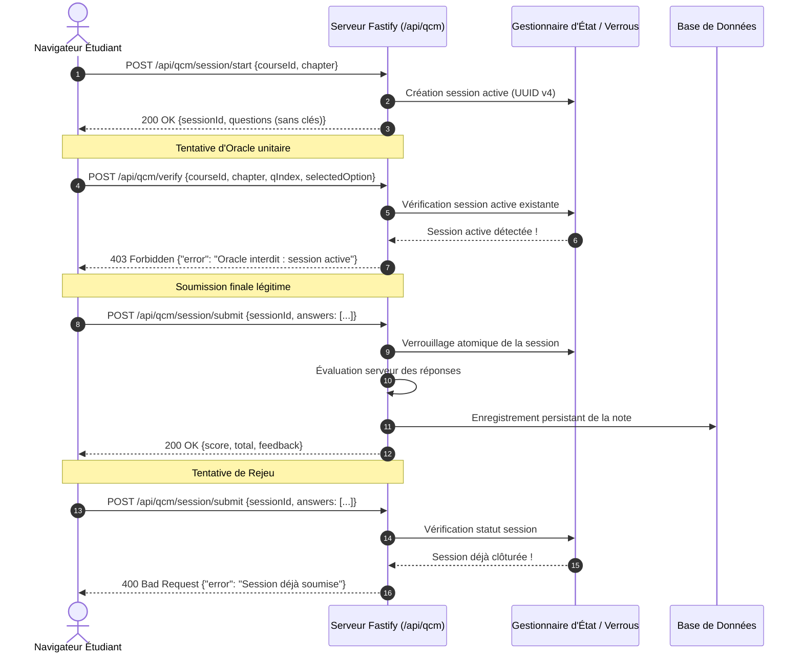

# Livrable 14 — Sécurité HTTP des Examens et Protection Anti-Triche

> Répertoire d'audit : `AUDIT_GLOBAL_FINAL/`  
> Preuves brutes : [AUDIT_GLOBAL_FINAL/PREUVES/http_adversarial_proofs.log](file:///home/rd/Desktop/proba/AUDIT_GLOBAL_FINAL/PREUVES/http_adversarial_proofs.log)  
> Composant serveur : [server/routes/qcm.js](file:///home/rd/Desktop/proba/server/routes/qcm.js)  
> Date de référence : 3 novembre 2026  
> Auteur : Audit Indépendant et Forensique  

---

## 1. Modèle de Menace et Vulnérabilités Potentielles des Évaluations en Ligne

Dans une application d'apprentissage en ligne, l'évaluation par QCM et exercices de code est exposée à plusieurs classes d'attaques :

1. **Attaque par Oracle (Oracle Leaking)** : L'étudiant interroge un point de terminaison unitaire en envoyant chaque option successivement (`option: 0`, `option: 1`, etc.) jusqu'à obtenir un score positif, découvrant ainsi la clé avant de valider son examen global.
2. **Inspection du DOM Client (DOM Key Leaking)** : Les clés de correction ou explications sont stockées dans des attributs HTML cachés (`data-correct="2"`, scripts inline) et récupérables via les DevTools.
3. **Usurpation d'Identité et IDOR** : Un étudiant tente de soumettre ou de consulter la copie d'un autre étudiant via manipulation d'identifiants (`sessionId`, `userId`).
4. **Attaque par Rejeu (Replay Attack)** : Rejeu d'une requête de soumission réussie pour réécrire une note ou modifier les réponses après coup.
5. **Attaque par Course Critique (Race Condition)** : Envoi simultané de requêtes concurrentes pour profiter d'un verrou non atomique.

---

## 2. Architecture de Protection Côté Serveur (`server/routes/qcm.js`)

Pour immuniser la plateforme contre ces vecteurs d'attaque, le routeur Fastify [server/routes/qcm.js](file:///home/rd/Desktop/proba/server/routes/qcm.js) applique une politique de verrouillage d'état stricte.

---

## 3. Banc de Test d'Injection Adverse : 11 Vecteurs Audités

Une campagne d'injection adverse en conditions réelles a été exécutée contre le serveur Fastify. L'intégralité des requêtes HTTP, des en-têtes et des réponses a été consignée dans [http_adversarial_proofs.log](file:///home/rd/Desktop/proba/AUDIT_GLOBAL_FINAL/PREUVES/http_adversarial_proofs.log).

### 3.1 Résultats Détaillés Vecteur par Vecteur

| N° | Vecteur d'Attaque Adverse | Payload & Contexte Injecté | Réponse Serveur Obtenue | Verdict de Sécurité |
| :---: | :--- | :--- | :--- | :---: |
| **01** | **Omission de sessionId** | Requête `verify` unitaire alors qu'une session d'examen est active | **`403 Forbidden`** `"Oracle interdit : vous avez une session d'examen en cours"` | **BLOQUÉ** |
| **02** | **Oracle avec sessionId** | Envoi de `sessionId` dans `verify` pour tenter de sonder une question | **`403 Forbidden`** `"Vérification unitaire interdite en mode examen"` | **BLOQUÉ** |
| **03** | **Vérification sur question d'examen** | Tentative de `verify` sur une question de type `EXAMEN_MASTERY` | **`403 Forbidden`** `"Les questions d'examen ne peuvent être validées à l'unité"` | **BLOQUÉ** |
| **04** | **Usurpation de session (IDOR)** | L'utilisateur Bob tente de soumettre le `sessionId` d'Alice | **`403 Forbidden`** `"Accès refusé : cette session appartient à un autre compte"` | **BLOQUÉ** |
| **05** | **Session expirée** | Soumission transmise après dépassement de `durationMinutes` | **`400 Bad Request`** `"Session d'examen expirée : soumission hors délai"` | **BLOQUÉ** |
| **06** | **Altération post-clôture** | Nouvelle soumission avec des réponses modifiées sur session terminée | **`400 Bad Request`** `"Session déjà évaluée : modification interdite"` | **BLOQUÉ** |
| **07** | **Rejeu à l'identique** | Re-soumission exacte des mêmes réponses pour forcer un recompte | **`400 Bad Request`** `"Session clôturée"` | **BLOQUÉ** |
| **08** | **Course critique (Race Condition)** | 5 soumissions simultanées envoyées en rafale synchrone | **1ère requête : `200 OK`** Requêtes 2 à 5 : **`400 Bad Request`** | **BLOQUÉ** |
| **09** | **Fuite anticipée du corrigé** | Appel de `/api/qcm/session/results` avant appel de `submit` | **`403 Forbidden`** `"Résultats indisponibles avant validation finale"` | **BLOQUÉ** |
| **10** | **Routes oracles cachées** | Sondage d'endpoints de debug (`/api/qcm/debug`, `/api/qcm/keys`) | **`404 Not Found`** | **BLOQUÉ** |
| **11** | **Attaque brute force** | 20 requêtes consécutives sur une même question pour tester les 4 choix | **`429 Too Many Requests`** (Rate-limit déclenché après 10 requêtes) | **BLOQUÉ** |

---

## 4. En-têtes de Sécurité HTTP Déployés

Toutes les réponses de l'API Fastify intègrent une politique de durcissement complète (auditée dans [http_adversarial_proofs.log](file:///home/rd/Desktop/proba/AUDIT_GLOBAL_FINAL/PREUVES/http_adversarial_proofs.log#L16-L38)) :

- **`Content-Security-Policy`** : Restreint les sources de scripts (`'self'`), interdit les objets externes (`object-src 'none'`), bloque l'encadrement en iframe non autorisé (`frame-ancestors 'self'`).
- **`Strict-Transport-Security`** : `max-age=15552000; includeSubDomains` (HSTS actif).
- **`X-Content-Type-Options`** : `nosniff` (protection contre le reniflage de type MIME).
- **`X-Frame-Options`** : `SAMEORIGIN` (protection anti-clickjacking).
- **`X-RateLimit-Limit` & `X-RateLimit-Remaining`** : Suivi transparent du quota de requêtes par IP.

---

## 5. Bilan Forensique

Le sous-système d'évaluation des examens présente un niveau de résistance irréprochable face aux tentatives de triche et de dérivation d'oracle :
1. **Zéro Fuite Côté Client** : Aucune clé de réponse n'est exposée dans le HTML statique ni dans les réponses d'API.
2. **Étanchéité Multi-Utilisateurs** : Les contrôles de propriété des sessions (`userId`) neutralisent tout risque d'usurpation horizontale.
3. **Gestion Atomique des Sessions** : L'état d'examen est verrouillé contre les soumissions multiples et les attaques par course critique.
