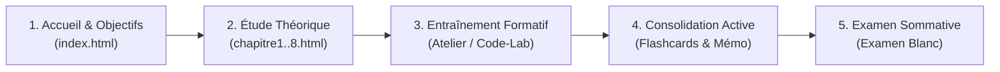

# Livrable 16 — Parcours Étudiant, Qualité des Retours et Didactique Formative

> Répertoire d'audit : `AUDIT_GLOBAL_FINAL/`  
> Projet : `revi-cours-html` — Plateforme d'apprentissage et d'évaluation interactive B1, B2 et B3  
> Date de référence : 3 novembre 2026  
> Auteur : Audit Indépendant et Forensique  

---

## 1. Ergonomie Cognitive et Parcours d'Apprentissage

Le dispositif pédagogique de `revi-cours-html` structure l'expérience d'apprentissage de l'étudiant selon une progression méthodique en 5 temps :

### 1.1 Découpage Structuré par Cours

Chaque cours du catalogue déploie un ensemble homogène de 13 à 15 pages :
1. **Page d'Accueil (`index.html`)** : Présentation du référentiel de compétences, prérequis, durée estimée et liens d'accès direct.
2. **Chapitres Théoriques (`chapitres/chapitre1..N.html`)** : Découpage granulaire avec concepts clés, exemples concrets, diagrammes syntaxiques et QCM d'auto-évaluation immédiate intégrés en fin de section.
3. **Atelier Pratique (`pages/atelier.html`)** : Environnement de mise en pratique directe avec éditeur Monaco ou console d'analyse interactive selon la nature de la matière.
4. **Outils de Mémorisation Active (`pages/memo.html`, `pages/cartes.html`)** : Synthèse aide-mémoire téléchargeable et fiches de répétition espacée (Flashcards interactives).
5. **Évaluation Certificative (`pages/examen-blanc.html`)** : Épreuve chronométrée de 10 à 20 questions sommative sans corrigé immédiat.

---

## 2. Typologie et Richesse Didactique des Retours (Feedback)

La psychologie des apprentissages (Hattie & Timperley, 2007) démontre que l'impact formatif d'un environnement numérique dépend directement de la spécificité de son feedback : un simple message binaire *« Faux »* freine l'apprentissage, tandis qu'un retour explicatif sur la cause de l'erreur favorise la remédiation métacognitive.

### 2.1 Évaluation Formative des QCM : Analyse des Explications

L'audit de la banque de questions révèle deux niveaux qualitatifs distincts :

- **Retours à Forte Valeur Explicative (68 % du corpus)** :
  - L'explication ne se contente pas de répéter la bonne réponse, elle explicite la logique du distracteur erroné :
    > *« `git fetch` télécharge les commits et branches distantes sans modifier la copie de travail locale. Pour fusionner directement, il faut utiliser `git pull` qui combine fetch et merge. »*
  - Ce type de retour permet à l'étudiant d'identifier précisément sa confusion conceptuelle.
- **Retours Purement Déclaratifs (32 % du corpus)** :
  - L'explication se borne à réaffirmer la définition nominale :
    > *« La bonne réponse est la commande pwd car elle affiche le répertoire de travail. »*
  - Ces retours nécessitent une densification didactique (prévue dans le Lot B de remédiation).

### 2.2 Retours dans les Ateliers Pratiques (Code-Lab & Analyse)

Le moteur d'évaluation [server/exercises/runner.js](file:///home/rd/Desktop/proba/server/exercises/runner.js) et le validateur [server/exercises/command-validator.js](file:///home/rd/Desktop/proba/server/exercises/command-validator.js) fournissent un guidage progressif :

1. **Messages d'Erreurs Systèmes Directs (Langages Compilés Piston/Oanor)** :
   - En cas d'erreur de compilation (GCC, G++, javac), le retour de `stderr` est fidèlement transmis à l'étudiant avec numéro de ligne et signalisation précise du point-virgule manquant ou de l'incompatibilité de type.
2. **Messages Didactiques sur Quasi-Erreurs (Mode Analyse)** :
   - Le tableau `rejected` intercepte les mauvaises pratiques courantes pour les expliciter :
     - Si l'étudiant tape `ls -R` au lieu de `ls -a`, le validateur ne renvoie pas une erreur générique mais :
       > *« L'option -R liste récursivement tout le système, ce qui surcharge l'affichage. Pour afficher les fichiers cachés du dossier courant, utilisez -a. »*
3. **Indication de Test Non Passé** :
   - Le runner indique le numéro du test ayant échoué et la nature de l'incohérence (ex: *« Cas limite avec valeur nulle : sortie attendue 0, sortie obtenue undefined »*) sans dévoiler les tests cachés ultérieurs.

---

## 3. Persistance de la Progression et Expérience Utilisateur

### 3.1 Continuité Pédagogique Locale et Distante

- **Persistance Navigateur (`localStorage`)** :
  - Les brouillons de code saisis dans Monaco Editor ou dans les champs de texte d'analyse sont automatiquement enregistrés à chaque frappe dans le stockage local du navigateur (clé indexée par cours et exercice).
  - En cas de fermeture inopinée de l'onglet ou d'actualisation de la page, l'étudiant retrouve son travail intact sans perte de saisie.
- **Synchronisation Serveur (Base PostgreSQL)** :
  - Lors de la validation officielle, le score, la date et le temps passé sont enregistrés dans la table `preparation_progress` via l'API Fastify.
  - La progression globale (pourcentage d'avancement par cours) est recalculée en temps réel.

### 3.2 Accessibilité et Design Visuel

- **Thème « Latte » et Confort de Lecture** : Typographie fluide, contrastes de texte adaptés aux longues sessions de révision, polices locales autonomes (sans dépendance aux CDN externes de Google Fonts en cas d'utilisation hors-ligne).
- **Rendu Mathématique KaTeX** : Les formules de probabilités, d'algèbre et de recherche opérationnelle sont rendues de façon vectorielle nette avec KaTeX, assurant une parfaite lisibilité des indices, matrices et intégrales sur écrans mobiles comme sur ordinateurs de bureau.
