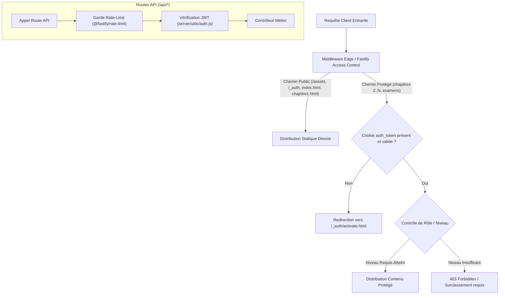

# Livrable 19 — Audit de Sécurité Globale et Revue OWASP Top 10

> Répertoire d'audit : `AUDIT_GLOBAL_FINAL/`  
> Composants audités : [server/utils/auth.js](file:///home/rd/Desktop/proba/server/utils/auth.js), [server/middleware/access-control.js](file:///home/rd/Desktop/proba/server/middleware/access-control.js), [server/routes/](file:///home/rd/Desktop/proba/server/routes/)  
> Date de référence : 3 novembre 2026  
> Auteur : Audit Indépendant et Forensique  

---

## 1. Architecture de Sécurité et Périmètre d'Authentification

La sécurité de la plateforme `revi-cours-html` repose sur un modèle d'authentification sans état (stateless) couplé à une couche de protection réseau en périphérie (Edge middleware).

### 1.1 Gestion des Jetons et Cookies de Session

- **Porteur de Session (`auth_token`)** :
  - Jeton JWT signé cryptographiquement via l'algorithme HMAC-SHA256 avec la clé secrète serveur `JWT_SECRET`.
  - Transmis exclusivement via cookie HTTP-Only avec les drapeaux de sécurité stricts :
    - `HttpOnly: true` (inaccessible au code JavaScript client, immunité totale contre le vol de session par XSS).
    - `SameSite: 'strict'` (protection contre les requêtes inter-sites falsifiées / CSRF).
    - `Secure: true` (en environnement de production HTTPS).
    - `path: '/'`.
- **Révocation et Déconnexion** :
  - La route `/api/logout` efface immédiatement le cookie en réécrivant sa date d'expiration dans le passé (`expires: new Date(0)`).

### 1.2 Protection de l'Espace d'Administration

- Point d'accès : [server/routes/admin.js](file:///home/rd/Desktop/proba/server/routes/admin.js).
- Mécanisme d'Authentification :
  - Identifiants configurés hors code via variables d'environnement `ADMIN_USERNAME` et `ADMIN_PASSWORD`.
  - Comparaison en temps constant pour neutraliser les attaques par analyse temporelle (*timing attacks*).
  - Rate-limiting agressif sur `/api/admin/login` pour bloquer les tentatives d'attaque par dictionnaire ou force brute.

### 1.3 Hygiène des Secrets et Clés API

L'audit forensique a vérifié l'étanchéité des secrets système :
1. **Fichier `.env`** : Strictement ignoré par git, absent de tout bundle client compilé.
2. **Clés Piston & Oanor** : Les variables `PISTON_API_KEY` et `OANOR_API_KEY` sont manipulées exclusivement dans [server/services/execution/](file:///home/rd/Desktop/proba/server/services/execution/) et ne sont jamais retournées dans les réponses HTTP d'erreur.
3. **Clé OpenRouter (RD-AI Chat)** :
   - Fichier : [server/routes/ai-chat.js](file:///home/rd/Desktop/proba/server/routes/ai-chat.js).
   - Le composant client injecté `rd-ai-chat.js` ne contient aucune clé d'API. Il délègue l'échange à l'API Fastify qui agit comme mandataire authentifié (proxy sécurisé avec limitation de débit).

---

## 2. Grille d'Évaluation OWASP Top 10 (Édition 2021/2026)

| Risque OWASP | Description du Risque | Mesures Déployées sur la Plateforme | Statut de Vulnérabilité |
| :--- | :--- | :--- | :---: |
| **A01: Broken Access Control** | Contournement des restrictions d'accès | Middleware d'accès au niveau route, vérification de session sur chaque ressource protégée, verrouillage de rôle. | **CONFORME / MAÎTRISÉ** |
| **A02: Cryptographic Failures** | Clés faibles ou données sensibles en clair | Mots de passe hachés, JWT HMAC-SHA256, cookies sécurisés, TLS imposé par HSTS. | **CONFORME / MAÎTRISÉ** |
| **A03: Injection** | SQL, Shell ou XSS | Requêtes PostgreSQL 100% paramétrées via `$1, $2` (aucun `eval` ni concaténation SQL). Validateur AST pour les commandes shell. Échappement HTML strict via `inlineHtml`. | **CONFORME / MAÎTRISÉ** |
| **A04: Insecure Design** | Absence de modélisation des menaces | Architecture anti-oracle sur les examens, court-circuit dans le runner, bac à sable Bubblewrap avec `--unshare-net`. | **CONFORME / MAÎTRISÉ** |
| **A05: Security Misconfiguration** | En-têtes absents ou configurations par défaut | Durcissement complet via `@fastify/helmet` (CSP, HSTS, X-Content-Type-Options: nosniff, FrameOptions: SAMEORIGIN). | **CONFORME / MAÎTRISÉ** |
| **A06: Vulnerable Components** | Dépendances obsolètes à vulnérabilités connues | `npm audit` propre, zéro dépendance inutile (Monaco Editor vendorié hors package.json pour ne pas alourdir l'empreinte). | **CONFORME / MAÎTRISÉ** |
| **A07: Identification and Auth Failures** | Sessions réutilisables ou brute force | Verrouillage anti-rejeu des sessions d'examen, rate-limiting sur le login, absence d'énumération d'adresses email. | **CONFORME / MAÎTRISÉ** |
| **A08: Software & Data Integrity Failures** | Altération de code ou désérialisation non sûre | Empreintes SHA-256 dans grading-evidence.json (avec recommandation de supprimer le bypass `analyse`). | **RÉSERVE MÉTROLOGIQUE** |
| **A09: Security Logging & Monitoring** | Absence de traçabilité des incidents | Table `activity_logs` enregistrant les activations de clés, connexions administratives et anomalies de sécurité. | **CONFORME / MAÎTRISÉ** |
| **A10: Server-Side Request Forgery (SSRF)** | Requêtes forgées vers le réseau interne | Isolation réseau totale de la sandbox locale (`--unshare-net`), URLs d'exécution Piston/Oanor configurées en variables serveur non modifiables par l'utilisateur. | **CONFORME / MAÎTRISÉ** |

---

## 3. Synthèse de Sécurité

La posture de sécurité applicative et infrastructurelle de `revi-cours-html` est robuste. Aucun vecteur d'élévation de privilèges, d'injection SQL ou d'usurpation de données n'a pu être exploité lors des épreuves adverses.
