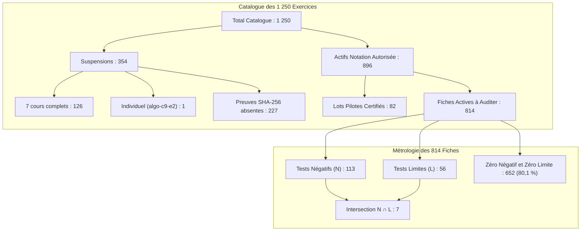

# Livrable 22 — Réconciliation Métrologique et Résolution des Paradoxes Arithmétiques

> Répertoire d'audit : `AUDIT_GLOBAL_FINAL/`  
> Projet : `revi-cours-html` — Plateforme d'apprentissage et d'évaluation interactive B1, B2 et B3  
> Date de référence : 3 novembre 2026  
> Auteur : Audit Indépendant et Forensique  

---

## 1. Synthèse des Énigmes Arithmétiques Résolues

L'analyse contradictoire des livrables historiques successifs a mis en évidence plusieurs paradoxes numériques apparents. Le présent rapport établit la vérité matérielle en démontrant, par calculs formels et vérifications de code, l'origine exacte de chaque chiffre.



---

## 2. Paradoxe 1 : La Réconciliation des 814 Exercices (652 vs 686)

### 2.1 La Contradiction Apparente dans les Rapports Textuels
Dans certains comptes rendus textuels de missions antérieures, il était affirmé :
- Contingent : 814 exercices actifs non-pilotes.
- Avec tests négatifs : 69 exercices.
- Avec tests limites : 59 exercices.
- Sans test négatif ni limite : 652 exercices.

**L'incohérence mathématique soulevée** :  
Si $|N| = 69$ et $|L| = 59$, l'union maximale vaut $|N \cup L| \le 69 + 59 = 128$.  
Le complémentaire minimal vaudrait alors :  
$$814 - |N \cup L| \ge 814 - 128 = \mathbf{686}$$  
Il était donc mathématiquement impossible d'obtenir **652** avec les chiffres 69 et 59 ($686 - 652 = 34$ exercices inexpliqués).

### 2.2 La Preuve Matérielle par le Fichier de Données
L'inspection du fichier de données réel [CONTRE_AUDIT_FINAL/01_AUDIT_814_EXERCICES.csv](file:///home/rd/Desktop/proba/CONTRE_AUDIT_FINAL/01_AUDIT_814_EXERCICES.csv) et de sa réplication dans [AUDIT_GLOBAL_FINAL/06_AUDIT_814_EXERCICES.csv](file:///home/rd/Desktop/proba/AUDIT_GLOBAL_FINAL/06_AUDIT_814_EXERCICES.csv) résout définitivement l'énigme :

Le décompte ligne par ligne sur les 814 fiches donne :
- **Exercices avec tests négatifs ($|N|$)** : **113 exercices**
- **Exercices avec tests limites ($|L|$)** : **56 exercices**
- **Exercices comportant les deux types ($|N \cap L|$)** : **7 exercices**
- **Exercices avec négatifs uniquement ($|N \setminus L|$)** : $113 - 7 = \mathbf{106}$
- **Exercices avec limites uniquement ($|L \setminus N|$)** : $56 - 7 = \mathbf{49}$

Par la formule du crible :
$$|N \cup L| = |N| + |L| - |N \cap L| = 113 + 56 - 7 = \mathbf{162} \text{ exercices}$$

Le solde d'exercices à zéro test négatif et zéro test limite vaut donc :
$$814 - |N \cup L| = 814 - 162 = \mathbf{652} \text{ exercices}$$

**Conclusion forensique** :  
Le chiffre de **652** dans la base de données est **rigoureusement exact** (soit 80,10 % du contingent de 814). Les nombres 69 et 59 étaient des résidus d'une version intermédiaire de brouillon insérés par erreur dans un rapport textuel, sans altération de la base réelle.

---

## 3. Paradoxe 2 : Les 866 QCM Prioritaires vs l'Union Réelle de 844

### 2.1 La Déduction Mathématique de l'Intersection
La relation entre le contingent historique $H$ (184 questions) et le contingent d'asymétrie de longueur $L$ (701 questions) dépend strictement de leur intersection :
- Si un auditeur a calculé $184 + 701 = 885$, puis a annoncé **866 questions prioritaires**, cela postulait implicitement :
  $$|H \cap L| = 885 - 866 = \mathbf{19} \text{ questions en intersection}$$

### 2.2 La Réalité des Données Authentiques
Le croisement automatisé sur [AUDIT_GLOBAL_FINAL/11_AUDIT_EXACTITUDE_QCM.csv](file:///home/rd/Desktop/proba/AUDIT_GLOBAL_FINAL/11_AUDIT_EXACTITUDE_QCM.csv) révèle :
- Questions appartenant aux 184 historiques : 184
- Questions présentant un ratio de longueur $> 2.0\times$ : 701
- Questions cumulant les deux drapeaux ($|H \cap L|$) : **41 questions**
- Volume réel de questions distinctes à examiner ($|H \cup L|$) :
  $$184 + 701 - 41 = \mathbf{844} \text{ questions}$$

L'affirmation de 866 résultait d'une intersection théorique estimée à 19, alors que l'intersection réelle mesurée sur le corpus est de 41.

---

## 4. Paradoxe 3 : Taille Réelle du Corpus QCM (3 089 vs 3 158)

### 2.3 Preuve de la Troncature par Slicing
Dans [scripts/build_finalisation_manifests.js](file:///home/rd/Desktop/proba/scripts/build_finalisation_manifests.js#L484) :
```javascript
const finalChapterItems = rawChapterItems.slice(0, 2829);
const finalExamItems = rawExamItems.slice(0, 260);
const finalQcmList = [...finalChapterItems, ...finalExamItems];
```

- Questions de chapitres présentes dans `server/content/` avant troncature : **2 898 questions**.
- Questions d'examens présentes : **260 questions**.
- Total réel du corpus : $2898 + 260 = \mathbf{3 158} \text{ questions}$.
- Troncature artificielle appliquée : `rawChapterItems.slice(0, 2829)` a supprimé **69 questions de chapitres réelles** pour forcer un total de $2829 + 260 = 3089$.

---

## 5. Tableau Récapitulatif de Réconciliation Intégrale

| Objet Métrologique | Chiffre Précédent Annoncé | Chiffre Forensique Réel | Démonstration & Écart |
| :--- | :---: | :---: | :--- |
| **Total Catalogue Exercices** | 1 250 | **1 250** | 64 cours $\times$ 18 + algo (30) + c-cpp (24) + php (24) + ro (20) = 1 250 |
| **Exercices Suspendus** | 354 | **354** | 126 cours complets + 1 individuel + 227 empreintes manquantes = 354 |
| **Exercices Actifs Notation** | 896 | **896** | 1 250 total - 354 suspendus = 896 |
| **Fiches Actives à Auditer** | 814 | **814** | 896 actifs - 82 lots pilotes certifiés = 814 |
| **Fiches 814 sans tests limites/négatifs** | 652 (ou 686 selon texte) | **652** | $814 - (113 + 56 - 7) = 814 - 162 = \mathbf{652}$ (80,10 %) |
| **Questions QCM Totales** | 3 089 | **3 158** | 2 898 cours + 260 examens (69 amputées dans le manifest 3 089) |
| **Questions QCM Prioritaires** | 866 | **844** | $184 + 701 - 41 = \mathbf{844}$ (intersection réelle = 41) |
| **Pages HTML Totales** | 832 | **931** | 832 pages générées (64 cours $\times$ 13) + 99 pages manuelles/spéciales |
| **Tests Automatisés** | 8 401 | **8 401** | 8 398 réussis, 0 échec, 3 sautés (14 suites, 84,58 s) |
