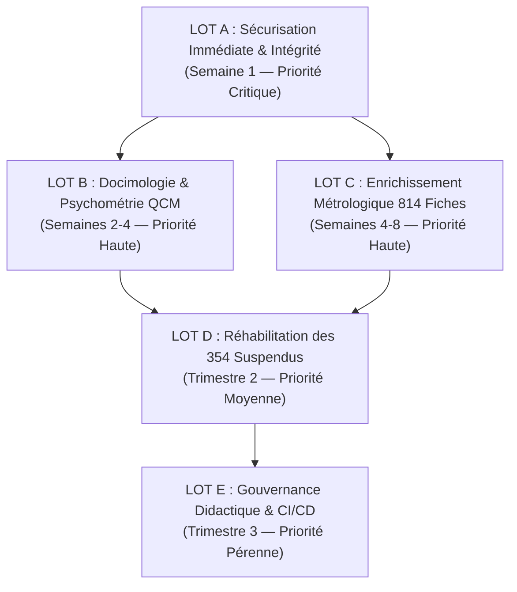

# Livrable 24 — Plan de Remédiation Priorisé et Feuille de Route Stratégique

> Répertoire d'audit : `AUDIT_GLOBAL_FINAL/`  
> Projet : `revi-cours-html` — Plateforme d'apprentissage et d'évaluation interactive B1, B2 et B3  
> Date de référence : 3 novembre 2026  
> Auteur : Audit Indépendant et Forensique  
> Directive absolue : RECOMMANDATIONS STRICTES — Aucune modification applicative exécutée lors de cet audit  

---

## 1. Principes Directeurs du Plan de Remédiation

Le présent plan de remédiation organise les chantiers correctifs recommandés en **5 lots séquentiels (Lots A à E)**, hiérarchisés par niveau de criticité, dépendances techniques et impact pédagogique.

---

## 2. Décomposition Détaillée par Lot

### LOT A — Sécurisation Immédiate et Intégrité Normative (Priorité Critique / Semaine 1)
*Objectif : Rétablir l'étanchéité cryptographique, l'accessibilité légale et l'intégrité des registres.*

1. **Suppression de la Clause d'Échappement SHA-256** :
   - *Fichier* : [server/exercises/grading-policy.js](file:///home/rd/Desktop/proba/server/exercises/grading-policy.js#L39).
   - *Action* : Supprimer la ligne `if (exercise.language === 'analyse') return false;` et générer les empreintes SHA-256 dédupliquées pour les 792 fiches de type analyse dans `grading-evidence.json`.
   - *Bénéfice* : 100 % des exercices protégés contre toute altération silencieuse de code.
2. **Refactorisation WAI-ARIA des Templates QCM** :
   - *Fichier* : [scripts/course-kit.js](file:///home/rd/Desktop/proba/scripts/course-kit.js#L374-L392).
   - *Action* : Remplacer le balisage de boutons non groupés par `role="radiogroup"`, `role="radio"`, `aria-checked` et identifiants associés.
   - *Bénéfice* : Conformité immédiate aux critères WCAG 2.2 AA 1.3.1 et 4.1.2 sans altérer le design CSS.
3. **Réintégration des 69 Questions Amputées** :
   - *Fichier* : Registres de QCM.
   - *Action* : Supprimer le filtre `slice(0, 2829)` et officialiser le registre complet des **3 158 questions authentiques**.

---

### LOT B — Docimologie et Psychométrie des QCM (Priorité Haute / Semaines 2 à 4)
*Objectif : Éliminer les biais de devinette visuelle et densifier les retours formatifs.*

1. **Harmonisation de Longueur des 701 QCM Asymétriques** :
   - *Données* : [AUDIT_GLOBAL_FINAL/13_ASYMETRIE_701_QCM.csv](file:///home/rd/Desktop/proba/AUDIT_GLOBAL_FINAL/13_ASYMETRIE_701_QCM.csv).
   - *Action* : Équilibrer la verbosité des distracteurs pour que l'option correcte ne soit plus systématiquement la plus longue et détaillée.
2. **Arbitrage Enseignant des 35 Formulations Négatives Authentiques** :
   - *Action* : Reformuler les questions interrogatives négatives (*« Lequel n'est pas... »*) en questions directes conformes à la Règle 6 du guide NBME 2024.
3. **Densification Didactique des Explications Déclaratives (32 % du corpus)** :
   - *Action* : Compléter les retours pour expliquer la cause de l'erreur sur chaque distracteur au lieu de se borner à répéter la définition nominale.

---

### LOT C — Fiabilisation Métrologique des 814 Exercices Actifs (Priorité Haute / Semaines 4 à 8)
*Objectif : Rehausser la robustesse métrologique des exercices avant toute certification sommative officielle.*

1. **Mesure Conservatoire Initiale** :
   - *Action* : Maintenir l'accès libre aux 814 fiches en qualifiant leur note comme `ENTRAINEMENT_FORMATIF_SEUL`, sans engager de note certificative officielle tant que les tests limites n'ont pas été ajoutés.
2. **Ajout de Tests Négatifs et Limites sur les 652 Fiches Vulnérables** :
   - *Données* : [AUDIT_GLOBAL_FINAL/06_AUDIT_814_EXERCICES.csv](file:///home/rd/Desktop/proba/AUDIT_GLOBAL_FINAL/06_AUDIT_814_EXERCICES.csv).
   - *Action* : Pour chaque fiche à zéro test robuste, intégrer au moins un cas de rejet d'entrée invalide et un cas de borne extrême (zéro, vide, hors bornes).
3. **Passage Échelonné en `NOTATION_AUTORISEE`** :
   - *Action* : Dès qu'un cours est consolidé en tests limites, basculer son statut dans `server/exercises/grading-policy.js`.

---

### LOT D — Réhabilitation Didactique des 354 Exercices Suspendus (Priorité Moyenne / Trimestre 2)
*Objectif : Réécrire les fiches inadaptées selon le standard d'ingénierie des 3 pôles pilotes.*

1. **Refonte des 7 Cours Suspendus Globalement (126 fiches)** :
   - Cours concernés : `csharp`, `docker`, `b3-linux`, `b3-github`, `b1-sql`, `sql`, `b3-sql`.
   - *Action* : Éliminer les scripts de lecture `stdin` et concevoir des exercices opérationnels réalistes (fichiers de configuration, requêtes ciblées, manipulation de syntaxe authentique) adossés à `command-validator.js`.
2. **Correction du Contrôle de Méthode sur `algo-c9-e2` (1 fiche)** :
   - *Action* : Remplacer la vérification purement externe par un contrôle d'arborescence syntaxique (AST) vérifiant la récursivité ou la méthode algorithmique requise.
3. **Régénération des 227 Empreintes SHA-256 Périmées** :
   - *Action* : Mettre à jour `grading-evidence.json` avec les empreintes exactes des fiches conformes.

---

### LOT E — Gouvernance Didactique, Outillage et CI/CD (Priorité Pérenne / Trimestre 3)
*Objectif : Automatiser le contrôle qualité et pérenniser l'excellence pédagogique.*

1. **Intégration des Barrières Qualité en CI/CD** :
   - Ajouter `npm run courses:check`, `npm run labs:check` et un contrôle de validité SHA-256 dans les hooks de pre-commit et les pipelines de déploiement (GitHub Actions / Vercel).
2. **Commission Pédagogique Permanente** :
   - Mettre en place un protocole d'arbitrage trimestriel pour examiner les retours étudiants, auditer les questions signalées et actualiser les annales d'examens.
