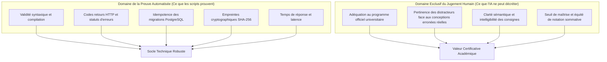

# Livrable 25 — Frontières de l'Automatisation et Périmètre d'Arbitrage Humain

> Répertoire d'audit : `AUDIT_GLOBAL_FINAL/`  
> Projet : `revi-cours-html` — Plateforme d'apprentissage et d'évaluation interactive B1, B2 et B3  
> Date de référence : 3 novembre 2026  
> Auteur : Audit Indépendant et Forensique  

---

## 1. Délimitation Épistémologique : Preuve Technique vs Jugement Didactique

L'audit forensique rappelle un principe déontologique fondamental : **un automate de test peut prouver l'absence de bug informatique, mais ne peut en aucun cas certifier la pertinence pédagogique d'une évaluation universitaire.**

---

## 2. Les Dérives de l'Automatisation Détectées lors de l'Audit

L'un des enseignements majeurs du présent audit est la mise en évidence des dérives méthodologiques survenues lorsqu'un script automatisé a tenté de se substituer au jugement docimologique :

1. **Génération de Quotas Factices** :
   - Dans `scripts/build_finalisation_manifests.js`, un algorithme a classé des questions parfaitement saines comme déviantes (`OPTION_TOUTES_AUCUNE`) simplement parce qu'elles contenaient le mot *« Quelle »*, afin d'atteindre un quota arbitraire de 46.
2. **Illusion de Conformité SHA-256** :
   - Un rapport antérieur déclarait « 100 % des exercices protégés par SHA-256 » en omettant une clause d'échappement qui désactivait en réalité le contrôle sur 792 fiches.

Ces précédents confirment la nécessité d'un strict cloisonnement : **les scripts automatisés doivent être cantonnés à la détection d'indicateurs objectifs, et les décisions éditoriales doivent être réservées aux enseignants.**

---

## 3. Registre des Décisions Réservées à la Commission Enseignante

Les quatre chantiers suivants ne peuvent en aucun cas être tranchés par une intelligence artificielle ou un script :

### 3.1 Validation Didactique des 844 QCM Signalés
- **Nature du travail** : Réécriture des énoncés ambigus, équilibrage de la longueur des distracteurs (701 cas), conversion des 35 formulations négatives.
- **Acteurs requis** : Enseignants titulaires des disciplines concernées (informatique, mathématiques, gestion).
- **Règle de décision** : Chaque distracteur doit représenter une erreur conceptuelle plausible fréquemment observée chez les étudiants lors des examens sur table.

### 3.2 Alignement des 814 Exercices sur les Annales Universitaires
- **Nature du travail** : Vérifier que les compétences évaluées correspondent aux attendus réels des partiels semestriels et des grilles de compétences RNCP.
- **Acteurs requis** : Responsables pédagogiques de filière (B1, B2, B3).
- **Règle de décision** : Supprimer toute consigne demandant d'émuler artificiellement un comportement système par des manipulations de texte inutiles.

### 3.3 Réhabilitation Pédagogique des 7 Cours Suspendus (126 fiches)
- **Nature du travail** : Réécrire entièrement les ateliers pratiques de `docker`, `csharp`, `b3-linux`, `b3-github`, `b1-sql`, `sql` et `b3-sql`.
- **Acteurs requis** : Experts techniques et formateurs professionnels de chaque matière.
- **Règle de décision** : Concevoir des scénarios basés sur de vrais livrables professionnels (Dockerfiles valides, schémas relationnels SQL, flux Git réels).

### 3.4 Définition des Seuils de Validation et Statuts de Notation
- **Nature du travail** : Fixer la note minimale de passage (ex: 60 % ou 70 %) et arbitrer si une matière autorise ou non les soumissions illimitées en session d'examen.
- **Acteurs requis** : Direction des études et jury d'examen.

---

## 4. Protocole d'Arbitrage et Charte de Validation

Pour chaque fiche ou question révisée par la commission :
1. **Émargement Contradictoire** : La fiche doit comporter le nom et la signature numérique de l'enseignant relecteur.
2. **Traçabilité des Modifications** : Tout changement de consigne ou d'option doit être archivé avec la justification didactique correspondante.
3. **Double Relecture sur les Évaluations Sommative** : Toute question destinée à une épreuve certificative officielle doit être relue par deux enseignants distincts.
