# Phase 1 — Graphe de Prérequis Macro (Entre Cours) & Analyse Topologique (DAG)

## 1. Constat Majeur sur les Prérequis Déclarés (`P7` / `C3`)

- **0 cours sur 68** ne comporte d'encadré ou de section structurée « Prérequis pédagogiques » en ouverture de `sommaire.html`, `index.html` ou `chapitres/chapitre1.html` indiquant à l'apprenant quels cours ou chapitres antérieurs doivent être maîtrisés avant de commencer.
- Le mot « prérequis » n'apparaît que dans deux contextes non reliés au graphe de compétences : `admin-vm/chapitres/chapitre2.html` (prérequis matériels BIOS/UEFI VT-x/AMD-V d'un serveur physique) et `b1-projet` (prérequis techniques d'installation de paquets).

## 2. Graphe Global des Dépendances Réelles et Anomalies Topologiques (Mermaid)

Le graphe ci-dessous représente les dépendances conceptuelles réelles déduites de la lecture intégrale des 68 cours actifs. Les **arcs en pointillés (`-.->`)** signalent les **cycles (`D3`), arcs manquants (`D1/D6`) et inversions temporelles (`D2`)**.

```mermaid
graph TD
  B1_ALGO["b1-algo (Algo B1 - Pseudo-code/Pascal)"]
  B1_PY["b1-python (Python B1)"]
  B1_CCPP["b1-c-cpp (C & C++ B1)"]
  B1_PHP["b1-php (PHP Procédural B1)"]
  B1_WEB["b1-prog-web (HTML/CSS/JS DOM B1)"]
  B1_ROBOT["b1-robotique (Robotique B1)"]
  B1_PROJ["b1-projet (Projet Stock Tkinter/SQLite B1)"]
  B2_PHP["php (PHP POO B2)"]
  B2_JAVA["rd_java (Java POO B2)"]
  B2_CSHARP["csharp (C# .NET B2)"]
  B2_PREP["preparation-web (12 Projets Web B2)"]
  B2_REACT["react (React B2)"]
  B2_FLASK["api-rest-flask (Flask REST B2)"]
  B3_ALGO["b3-algo (Algo Avancée B3)"]

  B1_ALGO -. "CYCLE D3 : Exos Ch.1 en Python !" .-> B1_PY
  B1_PY -. "CYCLE D3 : Suppose logique Algo" .-> B1_ALGO
  B1_ALGO --> B1_CCPP
  B1_ALGO --> B1_PHP --> B2_PHP
  B1_ALGO --> B2_JAVA
  B1_CCPP --> B2_CSHARP
  B1_WEB --> B2_PREP
  B2_PREP -. "ARC MANQUANT : JS ES6+ (fetch, map, modules)" .-> B2_REACT
  B1_PY --> B2_FLASK
  B1_PY --> B1_ROBOT
  B1_PY -. "ARC MANQUANT : POO Python & Tkinter non enseignés !" .-> B1_PROJ
  B1_ALGO --> B3_ALGO
  B1_PY --> B3_ALGO

  B1_ARCHI["b1-architecture (Circuits & Archi B1)"]
  B2_ASM["assembleur (Assembleur x86/AVR B2)"]
  B1_LIN["b1-linux (Linux B1)"]
  B2_LIN["linux (Admin Linux B2)"]
  B3_LIN["b3-linux (Linux Avancé Noyau/Cgroups B3)"]
  B1_GIT["b1-git (Git B1)"]
  B3_GIT["b3-github (Git & GitHub Actions B3)"]
  B2_DOCKER["docker (Docker B2)"]
  B3_DEVOPS["b3-devops (DevOps CI/CD SRE B3)"]
  B3_SUP["b3-supervision (Supervision Zabbix/Prometheus B3)"]
  B1_VIRT["b1-virtualisation (Virtualisation B1)"]
  B2_VM["admin-vm (Admin VM B2)"]
  B3_VIRT["b3-virtualisation (vSphere/vMotion/vSAN B3)"]
  B1_WIN["b1-admin-windows (Windows 2012 R2 & AD B1)"]
  B2_WIN["rd_winserver (Windows Server HA/VMware B2)"]
  B3_WIN["b3-windows-server (Windows Server AD/GPO B3)"]
  B3_CLOUD["b3-cloud-computing (Cloud Fondements B3 S1)"]
  B3_AWS["b3-cloud-aws (AWS B3 S2)"]
  B3_AZ["b3-cloud-azure (Azure B3 S2)"]
  B3_GCP["b3-google-cloud (GCP B3 S2)"]

  B1_ARCHI --> B2_ASM
  B1_CCPP --> B2_ASM
  B1_LIN --> B2_LIN --> B3_LIN
  B3_LIN -. "INVERSION B2/B3 : namespaces & cgroups vus en B3 mais requis en B2 !" .-> B2_DOCKER
  B1_GIT --> B3_GIT --> B3_DEVOPS
  B2_DOCKER --> B3_DEVOPS --> B3_SUP
  B1_VIRT --> B2_VM --> B3_VIRT
  B3_VIRT -. "INVERSION EXAMEN B2 : vMotion & Thin Provisioning évalués en B2 (epreuves) mais enseignés en B3 !" .-> B2_VM
  B1_WIN --> B2_WIN --> B3_WIN
  B2_VM --> B3_CLOUD
  B3_CLOUD --> B3_AWS
  B3_CLOUD --> B3_AZ
  B3_CLOUD --> B3_GCP

  B1_RES["b1-reseaux (Archi Réseaux B1)"]
  B1_CCNA["b1-ccna1 (CCNA 1 B1)"]
  B2_CCNA["ccna (CCNA Réseau B2)"]
  B3_LAN["b3-reseau-lan (LAN Avancé STP/OSPF/QoS B3)"]
  B3_FW["b3-firewall (Firewall Stateless/Stateful/Netfilter B3 S1)"]
  B3_PF["b3-pfsense (pfSense & Routage B3 S1)"]
  B3_VOIP["b3-voip (Téléphonie VoIP Asterisk/SIP B3 S2)"]
  B1_CYB["b1-cyber (Cybersécurité B1)"]
  B2_CYB["Cyber securite B2 (Cybersécurité B2)"]
  B3_CRYP["b3-cryptographie (Crypto & PKI X.509 B3 S2)"]
  B3_HACK["b3-hacking (Hacking Éthique B3 S2)"]

  B1_RES <--> B1_CCNA
  B1_CCNA --> B2_CCNA --> B3_LAN
  B2_CCNA --> B3_FW --> B3_PF
  B3_CRYP -. "INVERSION S1/S2 : PKI X.509, CRL & IPsec IKEv2 enseignés au S2 mais requis dès S1 (b3-pfsense Ch.5) !" .-> B3_PF
  B3_LAN --> B3_VOIP
  B1_CYB --> B2_CYB --> B3_CRYP
  B2_CYB --> B3_HACK

  B1_MER["b1-merise (MERISE MCD/MLD B1)"]
  B1_SQL["b1-sql (SQL B1)"]
  B2_SQL["sql (SQL B2)"]
  B3_SQL["b3-sql (SQL Avancé PostgreSQL B3)"]
  B2_UML["uml (UML 2.5 B2)"]
  B1_ALG["b1-algebre (Algèbre Linéaire B1)"]
  B1_STAT["b1-stats (Statistique Descriptive B1)"]
  B2_PROB["probabilites (Probabilités B2)"]
  B2_RO["RD-RO (Recherche Opérationnelle B2)"]
  B3_QUANT["b3-etude-quantitative (Étude Quant. & Qual. B3)"]

  B1_MER <--> B1_SQL
  B1_SQL --> B2_SQL --> B3_SQL
  B1_MER --> B2_UML
  B2_JAVA --> B2_UML
  B1_ALG --> B2_RO
  B1_STAT --> B2_PROB --> B3_QUANT
```

## 3. Liste Exhaustive des Cycles, Arcs Manquants et Cours Placés Trop Tôt / Trop Tard

### 3.1. Cycles de dépendance inter-cours (`D3` / Violation du DAG `P7`)

1. **Cycle `b1-algo` ⇄ `b1-python` (B1 — Bloquant S0)** : `b1-algo` enseigne l'algorithmique en pseudo-code et en Pascal, mais ses **30 exercices de code** (`b1-algo/chapitres/chapitre1.html:L148` à `chapitre10.html`) exigent d'écrire du code **Python 3** (`int(input())`, `print()`, `//`, `%`, `for ... in range()`, `def`, listes) sans qu'aucune section de `b1-algo` (avant le Ch. 10) n'enseigne Python. Inversement, `b1-python` suppose acquises la notion d'algorithme, la trace d'exécution et la décomposition en séquences/conditions/boucles de `b1-algo`.
2. **Cycle `b1-merise` ⇄ `b1-sql` (B1 — Majeur S1)** : `b1-sql/chapitres/chapitre1.html` et `chapitre2.html` utilisent d'emblée les concepts de clé primaire, clé étrangère, table d'association et cardinalités (enseignés dans `b1-merise` Ch. 4–5), tandis que `b1-merise/chapitres/chapitre5.html` formalise le passage du MCD au MLD à l'aide de requêtes SQL `CREATE TABLE ... PRIMARY KEY ... REFERENCES` (enseignées dans `b1-sql` Ch. 2).
3. **Chevauchement circulaire `b1-reseaux` ⇄ `b1-ccna1` (B1 — Majeur S1)** : Les deux cours B1 traitent les mêmes modèles OSI/TCP-IP, Ethernet et IPv4, mais `b1-reseaux` Ch. 1–2 mobilise des termes de commutation/routage expliqués dans `b1-ccna1`, tandis que `b1-ccna1` Ch. 1–2 s'appuie sur la taxonomie LAN/MAN/WAN et topologies de `b1-reseaux`.

### 3.2. Arcs manquants : Notions exigées par un cours mais enseignées nulle part avant (`D1` / `D6`)

| Cours aval | Notion / Compétence exigée | Preuve dans le dépôt (`fichier:ligne`) | Pourquoi c'est un arc manquant |
| :--- | :--- | :--- | :--- |
| `b1-algo` (B1) | Langage **Pascal** (`program`, `var`, `begin..end`, `readln`, `writeln`) | `b1-algo/chapitres/chapitre1.html:L55,L112-121` | Utilisé dans les 10 chapitres et l'examen blanc sans aucun cours ni chapitre d'introduction à Pascal. |
| `b1-projet` (B1) | **Programmation Orientée Objet Python & interface graphique `tkinter`** | `b1-projet/chapitres/chapitre3.html:L60-140` | `b1-python` s'arrête aux fichiers (Ch. 5) et au débogage (Ch. 6) : ni la POO Python ni `tkinter` ne sont enseignés en B1. |
| `b1-admin-windows` (B1) | **Scripting Bash Linux (`shell`)** pour administrer Windows | `b1-admin-windows/chapitres/chapitre1.html:L150` | Le cours porte sur Windows Server, mais ses 18 exercices demandent d'écrire des scripts Bash Linux (`read -r`, `case/esac`). |
| `rd_winserver` & `admin-vm` (B2) | **Langage PowerShell** (`Get-VM`, `New-VM`, cmdlets, pipelines) | `admin-vm/chapitres/chapitre1.html:L160`, `rd_winserver/chapitres/chapitre1.html:L160` | Les exercices exigent d'écrire du PowerShell dès le Ch. 1 alors qu'aucun cours B1 ou B2 n'enseigne la syntaxe PowerShell. |
| `react` (B2) | **JavaScript moderne ES6+** (`import/export`, arrow functions, destructuring, `.map()`, `.filter()`, `fetch`, Promises/`async-await`, npm/Vite) | `react/chapitres/chapitre1.html:L84-160`, `chapitre5.html:L90` | `b1-prog-web` Ch. 6 ne couvre que `querySelector` et `addEventListener` en ES5 basique ; `preparation-web` ne couvre ni les modules ES6, ni `fetch`/Promises, ni npm. |
| `probabilites` (B2) | **Calcul intégral et intégrales impropres** ($\int_{-\infty}^{+\infty} f(x)dx$, primitives exponentielles) | `probabilites/chapitres/chapitre5.html:L70-150` | Les mathématiques de B1 ne comprennent que `b1-algebre` (algèbre linéaire) et `b1-stats` (statistique descriptive) : aucun cours d'Analyse ne prépare aux intégrales. |
| `b3-cryptographie` (B3) | **Arithmétique modulaire** (indicatrice d'Euler $\varphi(n)$, identité de Bézout, inverse modulaire, théorème de Fermat) | `b3-cryptographie/chapitres/chapitre4.html:L84-135` | Mobilisés directement pour RSA et Diffie-Hellman sans avoir été enseignés en mathématiques B1/B2. |
| `b3-google-cloud` & `b3-devops` (B3) | **Orchestration Kubernetes (K8s : Pods, Deployments, Services, Ingress)** | `b3-google-cloud/chapitres/chapitre3.html:L95` | `docker` (B2) s'arrête à Docker Compose (Ch. 5) ; Kubernetes est supposé connu dans GKE/EKS/AKS sans cours ou chapitre dédié. |
| `b3-pfsense` (B3) | **Module standard Python `ipaddress` et syntaxe native OpenBSD `pf.conf`** | `b3-pfsense/chapitres/chapitre1.html:L189,L241` | Exigés dans les énoncés et indices des exercices du Ch. 1 sans jamais avoir été présentés dans le cours. |

### 3.3. Cours et chapitres placés trop tôt ou trop tard dans le cursus (`P7`)

1. **`b3-cryptographie` placé au Semestre 2 de B3 alors que `b3-pfsense` et `b3-firewall` sont au Semestre 1** : `b3-pfsense` Ch. 1 utilise `DNSSEC`/`RRSIG`/`DoT` et `b3-pfsense` Ch. 5 exige la maîtrise complète d'une **PKI X.509 (CA, certificats serveur/client, CRL), de TLS et d'IPsec IKEv2 (ESP, AES-GCM, SHA-256, Diffie-Hellman)**, qui ne sont enseignés qu'au Semestre 2 dans `b3-cryptographie` Ch. 2 à 6.
2. **`docker` (B2) placé avant `b3-linux` Ch. 4 (B3)** : dès le Chapitre 1 de `docker` (`docker/chapitres/chapitre1.html:L80-120`), l'isolation des conteneurs est expliquée par les **`namespaces` (`pid`, `net`, `mnt`, `uts`, `ipc`, `user`) et les `cgroups` du noyau Linux**, notions qui ne sont enseignées qu'un an plus tard en Licence 3 dans `b3-linux/chapitres/chapitre4.html`.
3. **`b3-virtualisation` (B3) enseigne `vMotion` et `Thin Provisioning` qui sont évalués dès l'examen officiel de B2 (`epreuves`)** : le sujet officiel de B2 *Administration des Machines Virtuelles* (`epreuves/Recueil_Epreuves_2024_2025.pdf` p. 11–12) interroge sur `vMotion`, `HA` et `thin provisioning`, or `admin-vm` (B2) ne les couvre pas et les renvoie de fait à `b3-virtualisation` Ch. 3 et Ch. 5.
4. **`b1-admin-windows` (B1) place Active Directory (forêts, arbres, contrôleurs de domaine AD DS) dès la 1re année sur un OS obsolète (Windows Server 2012 R2)**, avant même que l'étudiant maîtrise le DNS et l'adressage IP (`b1-reseaux` Ch. 5), puis `b3-windows-server` Ch. 2 ré-enseigne Active Directory en B3 comme s'il était nouveau.
5. **Triple redondance non coordonnée sur 3 ans** :
   - **SQL (`b1-sql` → `sql` B2 → `b3-sql` B3)** : les transactions `ACID`, les fonctions de fenêtrage (`OVER (PARTITION BY ...)`) et les déclencheurs (`Triggers`) sont enseignés à la fois en fin de `sql` B2 (Ch. 4–6) et ré-enseignés comme des nouveautés dans `b3-sql` (Ch. 1, Ch. 4, Ch. 5).
   - **Virtualisation (`b1-virtualisation` → `admin-vm` B2 → `b3-virtualisation` B3)** : le Chapitre 1 des trois cours répète la même distinction entre Hyperviseur de Type 1 (Bare-Metal) et de Type 2 (Hébergé).

## 4. Tableau Comparatif Prérequis Déclarés vs Prérequis Réels (71 Entrées)

| Cours (`id`) | Niv. | Prérequis déclarés dans le cours | Prérequis réels (cours/chapitres nécessaires) | Diagnostic d'alignement topologique |
| :--- | :---: | :--- | :--- | :--- |
| `linux` | B2 | Aucun bloc prérequis déclaré | b1-linux (Ch. 1–6), b1-reseaux (IP, SSH) | Redondant à 60 % avec b1-linux sur Ch. 1–3 ; exige réseau IP/SSH au Ch. 4 |
| `php` | B2 | Aucun bloc prérequis déclaré | b1-php (Ch. 1–8), b1-sql (Ch. 1–4) | PHP procédural (b1-php) et SQL (b1-sql) indispensables dès le Ch. 1 (POO) |
| `probabilites` | B2 | Aucun bloc prérequis déclaré | b1-stats (Ch. 1–4), b1-algebre, Analyse (intégrales pour Ch. 5) | Intégrales impropres (lois continues Ch. 5 : exponentielle, normale) jamais enseignées en B1 ! |
| `rd_java` | B2 | Aucun bloc prérequis déclaré | b1-algo (Ch. 1–8), b1-c-cpp (syntaxe C-like) | Algorithmique B1 ; Ch. 4–5 attaquent POO/Collections à un rythme soutenu |
| `rd_winserver` | B2 | Aucun bloc prérequis déclaré | b1-admin-windows, b1-reseaux, b1-virtualisation | Ch. 5–6 traitent de VMware ESXi/Snapshots ; exercices en PowerShell jamais enseigné avant ! |
| `admin-vm` | B2 | Aucun bloc prérequis déclaré | b1-virtualisation, b1-reseaux, b1-linux | Exercices en PowerShell non enseigné ; omet vMotion et Thin Provisioning pourtant à l’examen B2 ! |
| `droit` | B2 | Aucun bloc prérequis déclaré | b1-droit (Ch. 1–6) | Vocabulaire juridique de B1 (responsabilité civile/pénale, contrats) |
| `react` | B2 | Aucun bloc prérequis déclaré | b1-prog-web (HTML/CSS/DOM) + JavaScript ES6+ (non enseigné !) | Arc manquant critique : JS ES6+ (arrow functions, destructuring, map/filter, fetch/async, modules npm) |
| `api-rest-flask` | B2 | Aucun bloc prérequis déclaré | b1-python (Ch. 1–6), b1-prog-web (Ch. 1 HTTP), b1-sql | Décorateurs Python (@app.route), JSON, requêtes HTTP, SQLite/ORM |
| `erp-si` | B2 | Aucun bloc prérequis déclaré | b1-merise (Ch. 1 SI), b1-sql | Architecture client/serveur, bases de données relationnelles, API/JSON |
| `ingenierie-besoin` | B2 | Aucun bloc prérequis déclaré | b1-merise (Ch. 1–2), b1-projet (Ch. 1) | Notions de maîtrise d’ouvrage / maîtrise d’œuvre, cycle de vie logiciel |
| `masterclass-apprendre` | B2 | Aucun bloc prérequis déclaré | Aucun | Emploie du jargon neurobiologique (LTP, myélinisation, hippocampe) dès le Ch. 1 |
| `RD-RO` | B2 | Aucun bloc prérequis déclaré | b1-algebre (Ch. 1–3 matrices, pivot de Gauss) | Pivot de Gauss-Jordan, calcul matriciel et théorie des graphes |
| `assembleur` | B2 | Aucun bloc prérequis déclaré | b1-architecture (Ch. 1–6), b1-c-cpp (Ch. 5–6 pointeurs/pile) | Binaire, complément à 2, portes logiques, compilation C et pointeurs |
| `Cyber securite B2` | B2 | Aucun bloc prérequis déclaré | b1-cyber, b1-reseaux, b1-prog-web, b1-sql, b1-linux | Réseau TCP/IP, HTTP/SQL (OWASP Top 10 Ch. 4), cryptographie, Linux |
| `sql` | B2 | Aucun bloc prérequis déclaré | b1-sql (Ch. 1–6), b1-merise (Ch. 4–6) | Redondant sur Ch. 1–3 avec b1-sql ; introduit Window Functions (Ch. 4) et ACID/Triggers (Ch. 5–6) |
| `csharp` | B2 | Aucun bloc prérequis déclaré | b1-algo, b1-c-cpp ou rd_java (POO) | POO, génériques, lambdas ; exercices convertis en grilles statiques au lieu de code C# compilé ! |
| `ccna` | B2 | Aucun bloc prérequis déclaré | b1-ccna1 (Ch. 1–6), b1-reseaux (Ch. 1–6) | Reprend OSI/IPv4 aux Ch. 1–2 puis exige CLI IOS, STP, OSPF, 802.1Q |
| `uml` | B2 | Aucun bloc prérequis déclaré | b1-merise (modélisation), rd_java ou php (POO : classes, héritage, interfaces) | Requiert la POO (visibilité, héritage, interface, polymorphisme) dès le Ch. 3 |
| `uiux` | B2 | Aucun bloc prérequis déclaré | b1-prog-web (Ch. 2–5 HTML/CSS/Responsive) | HTML sémantique, CSS Flexbox/Grid, media queries, contraste couleurs |
| `docker` | B2 | Aucun bloc prérequis déclaré | linux (B2), b3-linux (Ch. 4 namespaces/cgroups !), b1-reseaux | Utilise dès Ch. 1 les namespaces et cgroups du noyau Linux enseignés seulement en B3 (b3-linux Ch. 4) ! |
| `infographie` | B2 | Aucun bloc prérequis déclaré | b1-algebre (Ch. 1–2 vecteurs et matrices 4x4 pour Ch. 4 3D) | Algèbre matricielle (transformations affines 3D TRS), binaire/octets |
| `preparation-web` | B2 | Aucun bloc prérequis déclaré | b1-prog-web (Ch. 1–6 HTML/CSS/JS DOM) | 12 projets pratiques HTML/JS ; utilise CodeMirror et exige manipulation DOM/événements |
| `epreuves` | B2 | Aucun bloc prérequis déclaré | Ensemble des cours B2 (probabilites, RD-RO, ccna, admin-vm, csharp, php, uml, rd_java) | Recueil d’annales B2 ; révèle des lacunes dans admin-vm (vMotion/Thin Provisioning) et csharp (code C#) |
| `b1-admin-windows` | B1 | Aucun bloc prérequis déclaré | b1-reseaux (IP, DNS, DHCP), b1-architecture | Active Directory (domaine/forêt), DNS, adressage IP ; exercices en Bash Linux ! |
| `b1-algebre` | B1 | Aucun bloc prérequis déclaré | Mathématiques Terminale | Calcul algébrique, systèmes d’équations |
| `b1-algo` | B1 | Aucun bloc prérequis déclaré | Aucun (fondamental B1) | Python 3 (input, int, print, //, %, range, def, listes) exigé dès le Ch. 1 dans les exercices → Cycle avec b1-python |
| `b1-anglais` | B1 | Aucun bloc prérequis déclaré | Anglais niveau A2/B1 lycée | Bases grammaticales anglaises |
| `b1-reseaux` | B1 | Aucun bloc prérequis déclaré | b1-architecture (Ch. 1–2 binaire/octets) | Parachute dès Ch. 1 Workgroup, Active Directory, NAS, pare-feu avant OSI (Ch. 3) et IP (Ch. 5) |
| `b1-bureautique` | B1 | Aucun bloc prérequis déclaré | Aucun | Manipulation de base d’un OS (fichiers, dossiers) |
| `b1-ccna1` | B1 | Aucun bloc prérequis déclaré | b1-reseaux (ou doublon direct) + b1-architecture (binaire/hexadécimal) | Binaire/hexadécimal pour IPv4/IPv6/MAC ; doublonne à 70 % avec b1-reseaux |
| `b1-architecture` | B1 | Aucun bloc prérequis déclaré | Mathématiques de base (puissances de 2) | Logique booléenne et puissances de 2 ; atelier.html utilise Bash (2#binaire) |
| `b1-robotique` | B1 | Aucun bloc prérequis déclaré | b1-python (Ch. 1–4), b1-architecture (Ch. 4 portes logiques) | Utilise dès Ch. 1 des générateurs Python et f-strings avant leur étude |
| `b1-cyber` | B1 | Aucun bloc prérequis déclaré | b1-reseaux (TCP/IP, ports, DNS, pare-feu), b1-linux / b1-admin-windows | Modèle OSI/TCP-IP, ports, chiffrement, hachage, SQL/XSS au Ch. 4 |
| `b1-droit` | B1 | Aucun bloc prérequis déclaré | Aucun | Culture générale civique et juridique |
| `b1-fr-pro` | B1 | Aucun bloc prérequis déclaré | Aucun | Grammaire française du secondaire |
| `b1-git` | B1 | Aucun bloc prérequis déclaré | b1-linux (Ch. 2–3 arborescence et CLI shell) | Ligne de commande shell, chemins de fichiers, éditeur de texte, SSH |
| `b1-c-cpp` | B1 | Aucun bloc prérequis déclaré | b1-algo (Ch. 1–7), b1-architecture (Ch. 1–3 binaire/mémoire) | Architecture mémoire (octets, adresses hexadécimales), terminal/compilateur GCC |
| `b1-linux` | B1 | Aucun bloc prérequis déclaré | b1-architecture (Ch. 1 OS/matériel) | Notions de système d’exploitation, fichiers, processus et réseau IP au Ch. 4 |
| `b1-merise` | B1 | Aucun bloc prérequis déclaré | Aucun (initiation SI) | Utilise SQL (CREATE TABLE, REFERENCES) au Ch. 5 avant b1-sql → Cycle avec b1-sql |
| `b1-php` | B1 | Aucun bloc prérequis déclaré | b1-algo (Ch. 1–6), b1-prog-web (Ch. 1–3 HTTP/HTML), b1-sql (Ch. 1–3 pour Ch. 8 PDO) | HTML/formulaires HTTP (utilisés aux Ch. 7–8) et SQL/MySQL (Ch. 8) |
| `b1-prog-web` | B1 | Aucun bloc prérequis déclaré | b1-algo (Ch. 1–4 pour JS au Ch. 6) | Notions réseau client/serveur et algorithmique de base pour le DOM JS |
| `b1-projet` | B1 | Aucun bloc prérequis déclaré | b1-python (complet + POO + Tkinter), b1-sql (SQLite), b1-git | Exige Tkinter (Ch. 3) et POO Python jamais enseignés en B1 ! |
| `b1-python` | B1 | Aucun bloc prérequis déclaré | Notions de base d’algorithmique (b1-algo Ch. 1–5) | Logique algorithmique (variables, conditions, boucles) supposée acquise → Cycle avec b1-algo |
| `b1-sql` | B1 | Aucun bloc prérequis déclaré | b1-merise (Ch. 1–5 MCD/MLD) | Clé primaire, clé étrangère, cardinalités et modèle relationnel (b1-merise) |
| `b1-stats` | B1 | Aucun bloc prérequis déclaré | Mathématiques Terminale (sommes ∑, racines) | Notation sigma ∑, lecture de tableaux |
| `b1-vb-excel` | B1 | Aucun bloc prérequis déclaré | b1-bureautique (Ch. 3–5 Excel), b1-algo | Cours ébauché (102 mots, archivé) — aucun chapitre disponible |
| `b1-virtualisation` | B1 | Aucun bloc prérequis déclaré | b1-architecture (CPU, RAM, stockage, IOPS), b1-reseaux (VLAN, SAN/NAS) | Parachute IOPS, SAN/NAS, Active Directory, pare-feu dès les Ch. 1–3 |
| `b3-algo` | B3 | Aucun bloc prérequis déclaré | b1-algo (Ch. 1–10), b1-python (Ch. 1–6), b1-algebre (logarithmes/suites) | Python 3 (listes, dictionnaires, récursivité), suites mathématiques et logarithmes |
| `b3-cloud-computing` | B3 | Aucun bloc prérequis déclaré | b1-virtualisation, admin-vm, docker, b1-reseaux | Virtualisation, conteneurs, réseaux IP/VLAN, stockage bloc/objet |
| `b3-devops` | B3 | Aucun bloc prérequis déclaré | b1-git, docker (B2), linux (B2), b3-github | Git, Docker, Linux shell, YAML, tests automatisés |
| `b3-document-technique` | B3 | Aucun bloc prérequis déclaré | ingenierie-besoin (B2), api-rest-flask (B2 pour OpenAPI Ch. 4), b1-git (Markdown) | Architecture SI, API REST/JSON/HTTP (Ch. 4), Git/CI-CD (Ch. 5 Docs-as-Code) |
| `b3-etude-quantitative` | B3 | Aucun bloc prérequis déclaré | b1-stats (Ch. 1–6), probabilites (B2 Ch. 3–6) | Statistique descriptive, loi normale, intervalles de confiance |
| `b3-firewall` | B3 | Aucun bloc prérequis déclaré | ccna (B2), Cyber securite B2, linux (B2) | TCP/IP, états TCP (3-way handshake), routage, CIDR, Linux CLI |
| `b3-github` | B3 | Aucun bloc prérequis déclaré | b1-git (Ch. 1–6), linux (B2) | Commandes Git de base, hachage SHA-1, SSH, YAML/Docker pour GitHub Actions (Ch. 5) |
| `b3-linux` | B3 | Aucun bloc prérequis déclaré | b1-linux, linux (B2), b1-architecture, b1-c-cpp (appels système) | Administration Linux B2, stockage disque, réseau IP/routage |
| `b3-agile` | B3 | Aucun bloc prérequis déclaré | b1-projet, ingenierie-besoin (B2) | Cycle de vie logiciel, gestion des exigences |
| `b3-pfsense` | B3 | Aucun bloc prérequis déclaré | ccna (B2), b3-firewall, b3-cryptographie (placé au S2 !), b3-reseau-lan | Exige CIDR, VLAN 802.1Q, NAT, états TCP, et au Ch. 5 PKI X.509/IPsec enseignés au S2 dans b3-cryptographie ! |
| `b3-reseau-lan` | B3 | Aucun bloc prérequis déclaré | b1-ccna1, ccna (B2 Ch. 1–6) | STP de base, VLAN 802.1Q, routage IPv4, CLI Cisco IOS |
| `b3-sql` | B3 | Aucun bloc prérequis déclaré | b1-sql, sql (B2 Ch. 1–6) | Redondant avec sql B2 sur ACID (Ch. 1), Window Functions (Ch. 4) et Triggers (Ch. 5) ; exige PostgreSQL |
| `b3-veille` | B3 | Aucun bloc prérequis déclaré | b1-stats, b1-algebre (vecteurs pour TF-IDF/cosinus au Ch. 4) | Logique booléenne, probabilités/vecteurs pour TF-IDF (Ch. 4) |
| `b3-windows-server` | B3 | Aucun bloc prérequis déclaré | b1-admin-windows, rd_winserver (B2), ccna (DNS/DHCP) | Ré-introduit AD DS déjà vu en b1-admin-windows Ch. 4–6 ; exige réseau IP et PowerShell |
| `b3-anglais` | B3 | Aucun bloc prérequis déclaré | b1-anglais, b3-cloud-computing, b3-agile, api-rest-flask | Mobilise l’architecture Cloud, REST API, Agile/Scrum et SRE en anglais |
| `b3-cloud-azure` | B3 | Aucun bloc prérequis déclaré | b3-cloud-computing (S1), b3-windows-server (AD/Entra ID), ccna (CIDR/VNet) | Modèles Cloud NIST, CIDR/routage, JSON, identités Active Directory |
| `b3-cryptographie` | B3 | Aucun bloc prérequis déclaré | b1-algebre, assembleur (XOR/binaire), Cyber securite B2 (Ch. 2) | Arithmétique modulaire (Bézout, Euler, Fermat au Ch. 4 jamais enseignés avant !), opérations binaires XOR |
| `b3-google-cloud` | B3 | Aucun bloc prérequis déclaré | b3-cloud-computing (S1), docker (B2), b3-devops (Kubernetes/GKE, Terraform) | Conteneurs Docker, Kubernetes (GKE au Ch. 3 jamais enseigné en détail avant !), réseaux VPC/CIDR |
| `b3-hacking` | B3 | Aucun bloc prérequis déclaré | Cyber securite B2, b3-linux, b3-reseau-lan, b1-sql, b1-prog-web | Linux avancé, TCP/IP, HTTP, SQL, OWASP Top 10, cryptographie |
| `b3-cloud-aws` | B3 | Aucun bloc prérequis déclaré | b3-cloud-computing (S1), docker (B2), ccna (CIDR/VPC) | Modèles Cloud, CIDR/routage/pare-feu, JSON (politiques IAM), conteneurs |
| `b3-supervision` | B3 | Aucun bloc prérequis déclaré | b3-linux, b3-reseau-lan, docker, b3-devops (SRE/SLI/SLO) | Linux, SNMP/UDP, PromQL, expressions régulières, Docker |
| `b3-voip` | B3 | Aucun bloc prérequis déclaré | ccna (B2), b3-reseau-lan (Ch. 6 QoS DSCP/802.1p), b3-linux, b3-pfsense (NAT/SIP) | UDP/TCP, QoS (DSCP/802.1p), NAT/pare-feu, Linux CLI (Asterisk) |
| `b3-virtualisation` | B3 | Aucun bloc prérequis déclaré | b1-virtualisation, admin-vm (B2), b3-reseau-lan (VLAN/LACP), b3-linux | Répète encore Type 1/Type 2 au Ch. 1 ; enseigne enfin vMotion et Thin Provisioning (évalués dès l’examen B2 !) |