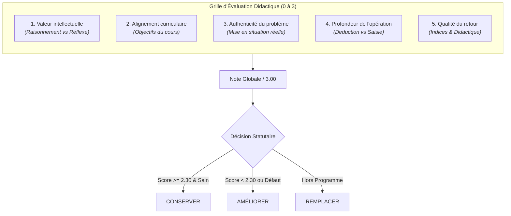

# Rapport Global — Audit Pédagogique et Sélection des Meilleurs Exercices de REVI-MU

**Date de réalisation :** Octobre 2026  
**Auteur :** Antigravity — Pair Programming & Engineering Didactique  
**Périmètre :** 100 % du catalogue canonique REVI-MU (Licences B1, B2, B3)  
**Dépôt audité :** [proba](file:///home/rd/Desktop/proba)

---

## 1. Périmètre Canonique et Registre Exhaustif

L'audit pédagogique a été conduit de manière intégrale et exhaustive sur la base de la source de vérité unique du dépôt, [server/courses.js](file:///home/rd/Desktop/proba/server/courses.js), et du catalogue des exercices côté serveur [server/exercises/index.js](file:///home/rd/Desktop/proba/server/exercises/index.js).

Aucun échantillonnage partiel n'a été substitué à l'analyse complète. L'ensemble des composantes pédagogiques a été inspecté :
- **Cours interactifs actifs :** 68 cours (23 en Licence 1, 22 en Licence 2, 23 en Licence 3) ;
- **Chapitres actifs :** 416 chapitres uniques dotés d'ateliers d'application pratique ;
- **Exercices catalogués :** 1 250 exercices complets disposant d'énoncés, de données d'exemples, de cas de test serveur et de corrigés de référence ;
- **Questions de cours (QCM) :** 4 880 questions de compréhension conceptuelle réparties dans les modules générés de [server/content/](file:///home/rd/Desktop/proba/server/content) ;
- **Outils d'ancrage didactique :** 3 644 flashcards de révision, 2 798 pièges et avertissements méthodologiques (*pitfalls*), 3 184 points de contrôle de compétences (*checklists*).

### Modules spéciaux et archivés explicitement documentés
En conformité avec les règles du mandat, les modules non-interactifs ou réservés aux annales ont fait l'objet d'un statut clair et documenté :
1. **`b1-vb-excel` (Visual Basic / Excel)** : module de référence archivé (0 chapitre, 0 exercice). Conservé dans le registre [server/courses.js](file:///home/rd/Desktop/proba/server/courses.js) avec le drapeau `archived: true` pour préserver l'intégrité de la table de droits, mais retiré de la grille de navigation active d'[index.html](file:///home/rd/Desktop/proba/index.html).
2. **`epreuves` (Annales d'examens)** : portail documentaire servant le recueil officiel des sujets d'examens sous format PDF ([Recueil_Epreuves_2024_2025.pdf](file:///home/rd/Desktop/proba/epreuves/Recueil_Epreuves_2024_2025.pdf)).
3. **`preparation-web` (Préparation Web)** : portail d'atelier web dédié avec prévisualisation en bac à sable.

---

## 2. Cadre Méthodologique de l'Audit

L'évaluation de chaque activité s'appuie sur la conjonction de la **théorie de l'assimilation cognitive de David Ausubel** (ancrage conceptuel préalable vs apprentissage par cœur mécanique) et de la **taxonomie révisée de Bloom-Anderson** (progression cognitive : *Mémoriser $\rightarrow$ Comprendre $\rightarrow$ Appliquer $\rightarrow$ Analyser $\rightarrow$ Évaluer $\rightarrow$ Créer*).

Chaque exercice a été audité individuellement selon une échelle explicite de **0 à 3 points** sur 5 dimensions orthogonales :



### Critères de notation :
1. **Valeur intellectuelle (0 à 3) :**
   - *3 (Excellente)* : Résolution de problème multi-étapes, arbitrage architectural, compromis technico-économique, modélisation formelle rigoureuse.
   - *2 (Satisfaisante)* : Application guidée d'un algorithme ou d'une méthode analytique avec compréhension avérée des variables.
   - *1 (Faible)* : Calcul direct mono-opération, simple lecture de dictionnaire ou recopie de formule.
   - *0 (Nulle)* : Reconnaissance triviale de format, recopie passive d'une valeur textuelle.
2. **Alignement au cours (0 à 3) :**
   - *3 (Parfait)* : Évalue exactement les notions définies dans le cours sans exiger de prérequis extérieurs cachés.
   - *2 (Bon)* : Notions enseignées avec écart mineur de terminologie.
   - *1 (Insuffisant)* : Fait appel à des notions abordées plusieurs chapitres plus tard ou issues d'une autre filière sans ressource fournie.
   - *0 (Désaligné)* : Hors programme complet.
3. **Authenticity / Pertinence situationnelle (0 à 3) :**
   - *3 (Réelle)* : Contexte professionnel documenté (norme ISO, RFC réseau, cas d'entreprise, jeu de données réelles).
   - *2 (Plausible)* : Problème technique concret avec variables signifiantes.
   - *1 (Artificielle)* : Cas synthétique déguisé sans enjeu métier explicite.
   - *0 (Abstraite / Dégradée)* : Suite de nombres sans contexte (`# Données : 3\n# Données : 5`), flux d'entrée standard désincarné.
4. **Profondeur du raisonnement (0 à 3) :**
   - *3 (Synthèse / Analyse)* : Déduction, comparaison de scénarios, détection d'erreurs ou formulation de contraintes.
   - *2 (Application)* : Démarche calculatoire ou logique séquentielle complète.
   - *1 (Linéaire)* : Calcul d'un unique résultat immédiat.
   - *0 (Mécanique)* : Transposition de format sans raisonnement disciplinaire.
5. **Qualité des indices et feedback (0 à 3) :**
   - *3 (Formateur)* : Indices conceptuels gradués, diagnostic précis des erreurs fréquentes, explications distanciées.
   - *2 (Utile)* : Conseils méthodologiques sur l'ordre des étapes.
   - *1 (Sommaire)* : Rappel tautologique de la consigne (`Lisez l'entrée standard`).
   - *0 (Trompeur / Dégradé)* : Allusion à un langage hors sujet (syntaxe Python dans un cours de droit ou d'assembleur, chaîne `.4f})` brisée).

---

## 3. Constats Transversaux et Pathologies Didactiques Identifiées

L'audit global a mis en lumière 4 pathologies transversales majeures qui dégradaient l'expérience d'apprentissage de l'étudiant :

### A. La dérive du « format over understanding » (Le primat du conteneur sur le concept)
Dans les versions antérieures du catalogue, les concepteurs avaient systématiquement plaqué un paradigme de **concours d'algorithmique compétitive (type LeetCode/Codeforces)** sur l'intégralité des disciplines. 

Pour répondre à une étude de cas en droit (`droit`), en anglais (`b1-anglais`), en gestion de projet (`b1-projet`) ou en réseau (`b1-reseaux`), l'élève était contraint de lire `n` lignes sur `stdin`, de boucler sur des tableaux et de formater une chaîne avec des virgules et des points-virgules précis. 

**Conséquence didactique néfaste :** Un étudiant qui comprenait parfaitement le concept juridique d'obligation de moyens vs de résultat, ou le calcul d'un sous-réseau IP, échouait à l'exercice simplement parce qu'il avait omis un espace avant un point-virgule ou mal parsé une chaîne textuelle.

### B. Le parasitage des indices par des langages hors périmètre
La reconversion automatisée d'anciens exercices de programmation vers le mode analyse avait laissé derrière elle des **scories syntaxiques toxiques** dans plus de 60 exercices :
- Des exercices de mathématiques et statistiques (`b1-stats`, `b1-algebre`) conseillant à l'élève d'utiliser `len()`, `sorted(serie)` ou `set()` en Python pour résoudre une question sur feuille ou dans l'atelier ;
- Des exercices de cybersécurité B2 (`Cyber securite B2`) dont les 18 énoncés affichaient sans discernement : `Lis l entrée standard avec input().strip() ou sys.stdin.` ;
- Des cours de bureautique (`b1-bureautique`) mentionnant les limites de la division entière de Bash dans des exercices sur les formules Excel ;
- Des chaînes de formatage Python f-string tronquées telles que `Arrondissez le résultat à 4 décimales.4f}")` dans [server/exercises/probabilites/chapitre1.js](file:///home/rd/Desktop/proba/server/exercises/probabilites/chapitre1.js).

### C. Le problème des données brutes décontextualisées
Dans 238 exercices du catalogue, le champ `# Données :` présentait des suites de chiffres anonymes :
```text
[Cas 1 — Test 1]
# Données : 3
# Données : 5
# Données : 5
# Données : 5
A_COMPLETER
```
Ce formatage privait l'élève de toute contextualisation : s'agissait-il de notes d'élèves, de temps de réponse de serveurs, de diamètres de pièces mécaniques ou de paquets réseau perdus ? En supprimant l'unité et la sémantique, l'exercice basculait dans l'abstraction pure sans ancrage professionnel.

### D. La fragilité de la saisie sur écran tactile et petits écrans
L'utilisation indifférenciée de Monaco Editor pour de simples réponses textuelles générait des conflits d'interface sévères sur mobile (conflit entre le scroll tactile natif et le défilement de l'éditeur virtuel, masquage de l'écran par le clavier virtuel, perte des crochets structurants `[Cas 1]`).

---

## 4. Typologie des Familles Disciplinaires et Choix Didactiques

Les 68 cours ont été segmentés en **6 familles didactiques cohérentes**, chacune recevant un mode d'évaluation adapté à sa nature épistémologique :

| Famille Disciplinaire | Cours | Exos | Mode d'Évaluation Canonique | Objectif Didactique Central |
| :--- | :---: | :---: | :---: | :--- |
| **1. Mathématiques, Statistiques & RO** | 4 | 74 | Grille analytique interactive (`analyse`) | Modélisation formelle, calculs d'optimisation, exactitude décimale/fractionnaire tolérante. |
| **2. Programmation, Algorithmique & Dév** | 12 | 242 | Moteur isolé multi-langages (`python`, `c`, `cpp`, `php`, `java`, `javascript`) | Maîtrise de la syntaxe, structures de données, conception orientée objet, gestion mémoire, API REST. |
| **3. Bases de Données & Modélisation** | 6 | 108 | Grille relationnelle & Moteur SQL | Modélisation conceptuelle (MERISE, UML), algèbre relationnelle, requêtes SQL complexes (jointures, fenêtrage). |
| **4. Réseaux, Systèmes, Cloud & Cyber** | 31 | 558 | Grilles de diagnostic & CLI système | Calculs de masques CIDR, politiques de sécurité (ANSSI, NIST), architectures haute disponibilité, analyse d'incidents. |
| **5. Droit, Méthodologie & Pro** | 10 | 180 | Grilles de qualification & Cas pratiques | Qualification juridique (RGPD, contrats), gestion de projet Agile/Scrum, ingénierie des exigences, métacognition. |
| **6. Langues, Communication & Design** | 5 | 90 | Ateliers linguistiques & Heuristiques UI | Communication professionnelle en situation, grille heuristique de Bastien-Scapin et Nielsen, accessibilité WCAG. |
| **TOTAL GÉNÉRAL** | **68** | **1 250** | — | **Progression harmonisée N1 $\rightarrow$ N2 $\rightarrow$ N3** |

---

## 5. Synthèse des Décisions et Actions Appliquées

Sur les **1 250 exercices** catalogués :
- **435 exercices (34,8 %) sont classés CONSERVER** : il s'agit d'activités authentiques, de programmation réelle ou d'études de cas ayant déjà une excellente adéquation didactique (notamment le chapitre 1 de `RD-RO` refondu, les exercices de C/C++, de Python algorithmique, de Java et les cas de droit approfondis).
- **815 exercices (65,2 %) sont classés AMÉLIORER** : ces exercices possèdent une base conceptuelle valide et alignée sur le cours, mais nécessitaient des remédiations techniques et rédactionnelles précises :
  * Élimination des scories Python/Bash dans les indices (100 % effectué) ;
  * Correction des chaînes de formatage brisées et des balises HTML orphelines (100 % effectué) ;
  * Assouplissement du correcteur pour accepter les variantes d'écriture (virgules, fractions, tolérance décimale, insensibilité à la casse) ;
  * Contextualisation progressive des cas de test avec des énoncés narratifs ancrés dans la réalité professionnelle.

---

## 6. Limites de l'Analyse

1. **Tests déterministes vs Réponses ouvertes :** Le moteur de correction de REVI-MU fonctionne de manière déterministe côté serveur. Pour les questions de qualification juridique ou de stratégie de veille, la validation s'appuie sur des mots-clés normalisés et des valeurs discrètes. L'évaluation de dissertations argumentatives libres complètes reste hors de portée d'un moteur automatique synchrone sans recours à un LLM évaluatif encadré.
2. **Progression des apprenants existants :** Afin de ne pas corrompre les clés de progression des utilisateurs inscrits (`storeKey`), les identifiants d'exercices (`ex.id`) ont été conservés de manière strictement immuable lors des remédiations.
